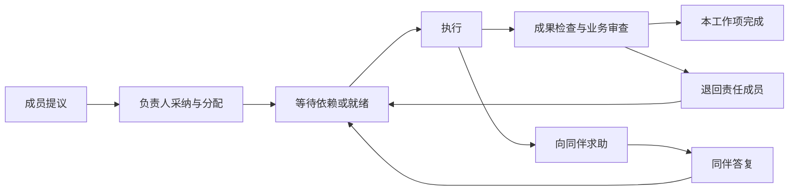

# Plan: CLI Team 持续业务协作工作台

_2026-11-11 · 通过 grill 访谈收敛业务边界；实现默认值列明于下文。原方案已获批准。2026-11-12 用户授权结合 LibreChat 与 solo-to-team-skills 整体升级，当前实施顺序与新增协作契约见 [整体升级方案](docs/plans/2026-11-12-team-upgrade.md)。_

## Goal

把 CLI Team 升级为能持续推进业务的本机团队工作台。用户交代长期目标后，成员共享项目资料，围绕具体成果调研、制作、求助、互审和返工；负责人安排优先级、处理分歧、收敛成果。首个业务模块跑通一个小红书账号的图文笔记：选题 → 文案与配图 → 团队审查 → 用户批准当前整稿 → 发布与核对 → 数据复盘 → 下一轮工作。用户日常主要确认发布，不负责逐步派工。每个状态都能追溯到实际工作、成果版本和证据。

### 已确认的产品边界

- 保持通用业务团队工作台定位，小红书是首个业务模块。
- 首期做图文笔记。
- 团队负责运营安排，用户保留最终发布确认权。
- 程序在本机后台工作；关机或离线期间不要求继续运营。重新打开后核对进度再恢复，错过的时段重新安排，不集中补发。
- 用户当前没有指定图片生成工具或服务。
- 核心改进是实质协作和操作体验，不以增加聊天数量作为合作完成的证明。

### 本方案采用的实现默认值

- 配图首期使用可信本地模板自动排版封面、信息卡，以及用户导入的素材；实际渲染 PNG。可替换的 AI 生图服务为扩展点，不要求用户现在选择供应商或购买服务。模板排版明确标注为模板制作。
- 初始模板面向知识、经验、清单等可由图文卡片表达的内容。需要真实产品、人物或场景照片时使用有来源的素材；缺少必要素材时报告缺口，不用生成图片冒充真实实拍。
- 一个业务项目绑定一个发布账号；团队可在此项目内处理多篇笔记。成员配置、工具接入和限额在设置中完成，不进入每篇内容的日常操作。
- 保留可选的“告诉团队”和直接联系成员入口；用户不参与时，团队也能按已授权目标推进。
- 默认最多积压 3 篇待批准稿件，避免无人审批时持续堆积内容。频率、选题和岗位分配由负责人在限额内安排。

## Approach

### 1. 保留现有任务，增加独立的业务协作层

继续使用 Node.js 24+、ESM、Express、SQLite、React、TypeScript。复用 CLI 适配、参数数组启动、成员占用、诊断、材料导入、文件检查、版本指纹、草稿恢复和事件流。

现有实现的具体边界：

- `server/service.mjs:1064` 的 `dispatchDelegatedStep` 以一个任务全局阶段控制顺序执行；任一步运行、等待或审查时，其他步骤不派发。
- `server/delegation-context.mjs` 已经传递绑定运行 ID 的依赖结果；`server/task-assistance.mjs` 已有负责人协调的求助链。
- `server/task-supervision.mjs` 已区分成员结论、文件检查、独立评审与最终机器证据，应保留这一原则。
- `server/service.mjs:1337` 的会议有提案、质疑与汇总，但结束只生成通知。
- 现有成果登记会替换当前任务文件清单，不能直接充当不可变内容版本库。
- `Store.afterCommit` 是进程内回调，不能承担崩溃后的可靠派工。

新业务工作项使用自己的协调器与调度状态机，不把旧任务的单一 `coordination.phase` 扩展成全项目锁。旧 `tasks`、房间、文件目录、任务验收和 HTTP/CLI/MCP 接口继续运行；新运行通过明确的 `workflowKind: 'business'` 路由到新驱动器，旧运行走原驱动器。

建议模块边界（以下均为拟新增或修改，不表示已实现）：

| 责任 | 模块 |
| --- | --- |
| 项目、周期、资料与事实 | `server/projects.mjs`、`server/project-context.mjs` |
| 工作项与事件调度 | `server/business-work.mjs`、`server/business-scheduler.mjs` |
| 成员协作与负责人决策 | `server/business-collaboration.mjs` |
| 内容版本与收取成果 | `server/content-revisions.mjs` |
| 模块契约与图文校验 | `server/business-modules/` |
| 工具能力、调用账本 | `server/business-tools.mjs` |
| 发布审批、执行与回读 | `server/publications.mjs`、`server/connectors/xiaohongshu.mjs` |
| 可信模板渲染 | `desktop/content-renderer.mjs`、`desktop/content-templates/` |
| 业务页面 | `ui/projects/`、`ui/content/`、`ui/publications/` |

`TeamService` 负责装配与旧接口兼容，不继续把业务状态机集中堆入 `service.mjs`。先提取供两类运行共享的执行接口，再引入新驱动器；执行回调必须只进入一种驱动器。两类协调器共用一个实际执行调度器，统一全局并发、成员占用、取消与进程回收；不能让旧 `pump()` 与新消费者分别发放同一成员的运行资格。

业务运行的原生 CLI 会话以 `projectId/workItemId/generation/attemptId/memberId/role/permission/runtimeFingerprint/workspace/inputDigest` 为完整身份。每个新 attempt 默认新建原生会话，不读取旧任务或房间的会话回退键。一次 attempt 内的受控多轮继续只在上述身份全部一致且没有并发原生会话写入时恢复；工作目录、输入或权限变化立即换会话。咨询使用独立会话。先在公共执行接口实现这条约束，再启用新业务调度；generation 检查不能代替原生会话隔离。

### 2. 建立项目、工作项和不可变成果模型

复用 SQLite，采用带版本号的前向迁移。已有 `entities(kind,id,data)` 可以保存业务实体；并发租约、唯一请求、队列和预算使用显式字段与约束的表，不能用“先查询再插入”的约定替代唯一约束。

**旧版写入屏障：** 新版 Store 在任何 DML 前注册返回构建期常量的连接级函数 `cli_team_writer_version()`；迁移在 `entities`、`events` 及新状态表上安装 BEFORE INSERT/UPDATE/DELETE 触发器，要求该函数满足数据库的 `minimumWriterVersion`。已知旧版没有注册该函数，必经的状态写入会报错并拒绝，而不是依靠旧版理解新 schemaVersion。函数只是兼容性防护，不是抵御任意本机进程的权限沙箱。实测必须覆盖当前 0.1.0 Store 的启动/恢复、首次写入和迁移前已打开连接的写入，确认没有部分状态变化。若这个屏障在目标 SQLite/Node 版本下未被证明有效，不执行生产迁移。

迁移在新 `seed/recover` 之前进行。先验证工作区无活动旧任务/队列/验证进程并取得调度归属，在独占写事务内再次检查；不能确认旧运行已停止时要求先停止旧版，不带运行中的用户工作迁移。使用 SQLite 一致性备份（包括 WAL 状态）及必要文件清单，原子安装版本号与全部写入屏障。回滚只恢复到独立目录中的完整旧版快照，不让旧版原地接管已升级状态。文件与旧任务 ID 保留，备份不包含官方 CLI 凭证。

| 对象 | 关键字段与约束 |
| --- | --- |
| Project | 业务模块及版本、目标、简报版本、团队、时区、账号绑定、工具绑定、运行状态、预算、待审上限、`revision` |
| ProjectFact | 类型、内容、来源引用、提出者、采纳者、版本、替代关系；事实、判断、偏好分别标识 |
| ProductionCycle | 项目、当地日期/周期键、当前目标、状态、复盘引用；同项目最多一个活动生产周期 |
| WorkItem | 项目/周期/内容、责任成员、目标、输出契约、依赖、精确输入引用、优先级、状态、`generation`、当前 attempt |
| CollaborationThread / Action | 发起运行、收件人、引用版本、动作类型、问题与答复、处理运行、状态 |
| ContentItem | 稿件身份、项目、当前草稿版本、当前待审版本、状态、发布记录引用 |
| ContentRevision | 不可变标题、正文、话题、有顺序的图片、素材哈希、来源、模板版本、父版本、规范化 manifest 与摘要 |
| ContentEligibility | 当前可送审资格修订号、有效/失效状态、输入依赖版本、检查与业务审查版本、失效原因 |
| ContentCheck / Review | 绑定 manifest 的确定性检查及内部业务审查，各自独立记录，包含执行者与时间 |
| PublicationApproval | 用户、稿件 manifest、目标账号、发布参数和时间范围、批准时间、状态、修订号 |
| Publication / Attempt | 发布请求、审批、账号、冻结 payload、尝试状态、调用结果、平台回读证据与异常 |
| MetricsSnapshot | 平台笔记身份、指标名、值或缺失原因、来源、采集时间、原始证据引用 |

运行继续保存到 `runs`，新增业务项目、工作项、generation、attempt、输入摘要、job、lease 等关联。接口请求的 actor 从已验证的连接身份取得，不能由客户端或成员在 JSON 中自报为用户。

**文件收取顺序：** 工作成员只写本次 attempt 目录；输入是已登记的固定副本，输出有声明路径。子进程退出后检查普通文件、路径、链接、输入完整性、大小、格式和实际哈希，再写入服务管理的不可变成果区。文件完整落盘后，才在数据库事务中引用它。相同哈希可复用，不能覆盖已被版本引用的文件。崩溃产生的未引用文件标为孤立对象，不自动删除用户目录。

每个工作项拥有独立 attempt 目录，同一逻辑成果如“某稿封面”只由一个工作项生产；其他成员通过修改请求协作。目录分离不宣称为操作系统沙箱，继续遵守官方客户端权限与现有文件边界检查。

### 3. 让协作动作驱动实际工作

工作项主线：



此外显式支持 `waiting_answer`、`interrupted`、`failed`、`cancelled`、`superseded`。项目的 active/paused/attention/archived 是运行总开关，不代替工作项状态。

成员报告新增版本化动作协议：`ask_peer`、`contribute`、`request_revision`、`propose_work`、`propose_fact`、`request_tool`。旧协议继续兼容。每个动作的唯一键绑定 `sourceRunId + actionIndex`，执行前校验运行身份、当前 generation、项目归属、收件人、动作权限、输入版本、大小与预算。报告正文、网页内容和文件内容始终作为不可信上下文，不能扩权。

- 对已授权成员的有限咨询直接生成收件人的工作，并把答复自动送回原线程。只有依赖此答案的工作项等待。首期咨询是叶节点，只能答复或报告缺口，不能再次 ask_peer、propose_work 或发起其他咨询。根求助链最多 2 轮，线程重建或换工作项不能重置根链计数；未解决就交负责人作出答复、改计划或明确受阻。
- 同伴可以指出具体稿件问题；改稿由原责任成员处理，处理结果回到同一线程。争议交给负责人收敛。
- 新工作、优先级调整、范围变化和记忆采纳由负责人提出决定，再由服务器校验范围与限额后落地。
- 成员没有创建发布审批、批准自己成果、任意启动程序或自由添加工具的能力。
- 讨论结论可生成结构化行动提议。服务器去重、负责人采纳后产生工作项；只有摘要没有后续动作的讨论仍是讨论。
- 问题线程使用 pending/delivered/answered/resolved/rejected/superseded 状态；送入上下文不等于已经解决。

普通依赖与动态等待关系统一检查环。新增等待边时，在事务中核对当前 generation 的等待图；咨询读取已经提交的输入快照，不等待请求方未来产物。依赖方失败、取消、被替代或超时必须向等待者发送明确的终结事件，令其重新规划或进入带原因的受阻状态，不能永久等待。

**并行与版本：** 无依赖且成员不同的工作项可并行。一个成员和一个工作项同时最多一个 attempt。每次重做产生新 attempt；输入变更、取消或重规划递增 generation。结果收取、评审、协作动作都校验当前 generation 与 lease，旧运行晚到不得提交或发起后续动作。

输入引用绑定具体事实/成果版本。上游修订只使实际依赖它的未发布分支失效；无关分支保留。失效事务同步递增受影响的 ContentEligibility 修订号，使其检查、内部审查和未执行发布批准失效，并撤销未进入 sending 的对应作业；不能等到修订稿生成后才撤销旧批准。状态、事件和取消意图同事务提交，执行前再次核对资格版本。已经 sending 的冻结快照不能被伪装成未发送，记录资料纠正与潜在影响以便核实。已发布版本与其证据保持历史事实，新修改是新稿件版本。负责人集成也走工作项和版本收取规则。

**项目上下文：** 每次运行收到目标与简报版本、相关已采纳资料、精确成果输入、待解决问题和当前分工。采用有上限的按需选择；不无限拼接聊天，不把旧模型自述提升为事实。新周期可以引用旧周期有出处的复盘与资料。

### 4. 用可靠队列恢复本机持续工作

在同一个短 SQLite 写事务中完成 revision/generation 比较、状态转换、预算预留、动作去重和 outbox 插入。外部进程与网络调用只能发生在事务提交之后；`afterCommit` 仅唤醒消费者。outbox 至少一次读取，通过唯一任务键实现内部动作去重。

新增 `jobs`、`resource_leases`、`request_keys`、`budget_ledger` 约束与索引。队列领取使用事务和 compare-and-swap；lease 包含 fencing generation。结果写回必须持有当前 token。一个工作区只能有一个活动调度所有者；另一后端实例不能靠不同 HTTP 端口绕过工作区归属。

任务状态、作业租约、成员占用与 UI 等待原因使用同一组判定函数。内部咨询仍服从全局并发和成员锁，避免原成员等待同伴却占着唯一可运行槽位。

首期默认限额：

- 工作区并行沿用当前默认 2，可在既有范围内配置。
- 同项目一个活动生产周期；每天最多发起一次新的计划周期。日期按项目时区计算，唯一周期键防止重复触发。
- 每项目每自然日最多 24 次 CLI 调用，包含负责人、咨询、返工和评审；不是每次重建周期重新获得预算。单次沿用 10 分钟超时。
- 每工作项最多 3 个 attempt；每根求助链最多 2 轮咨询。新稿开始生产前必须在事务中预留一个稿件名额，“已预留的生产中稿件 + 待批准 + 已批准待执行 + 发布中/结果不明”合计最多 3 篇。返工复用同一稿件名额，换 generation、周期或工作项不能增加名额。只有已核实发布或明确放弃且不存在未决外部提交时释放；暂停、退回、失败或 unknown 不释放。名额已满仍可推进已有稿件，不能启动新稿。
- 预算在派工事务中原子预留。已开始或启动状态不明的调用不退预算；只有证明没有启动的调用才退还。
- 预算不足显示等待下一额度，已有工作保留。成员不能修改预算；CLI 没有报告的 token 或费用显示未知。没有配置的付费服务不能调用。

关闭窗口时保存草稿并隐藏到托盘，后台继续运行；托盘提供打开、暂停全部、明确退出。完全退出和工作区切换仍使用可靠的停止与保存握手。图文渲染窗口默认隐藏。

暂停先持久化禁止新派工，再停止并等待已知进程退出。重启先恢复工作区归属、读取 outbox、核验旧进程身份、输入与有效检查点，确认没有旧进程后才恢复内部工作。无法证明旧进程已退出时隔离该成员/attempt 并显示原因，不能仅凭租约过期重跑。旧结果仍受 generation 校验。

停机错过的生产周期合并为当前一次重新规划，继续未完成工作，不补跑所有历史周期。发布动作使用下节独立账本，不能按普通内部 job 自动重放。

### 5. 首个模块交付可审阅的完整图文

通用模块契约声明版本、业务对象、推荐工作流、角色能力、允许的工具、确定性检查与审批类型。首期模块由应用自带并纳入版本控制；不执行用户或成员上传的任意插件代码。

小红书图文工作流：负责人规划 → 资料/选题 → 文案与视觉制作 → 互审和返工 → 整稿检查 → 提议排期 → 用户批准 → 发布/核实 → 指标采集/复盘。适合并行的资料与视觉准备可同时推进，只有明确依赖最终文案的版面才等待。

**默认配图：** 成员输出受限模板数据与已登记素材引用。可信渲染器从内置模板选择版式，在固定画布生成真实 PNG，禁止执行成员生成的 HTML/JS，禁止远程资源、导航、任意路径与命令。Electron 渲染使用隔离上下文、无 Node、启用 sandbox 的隐藏窗口。输出进入同一成果版本库。字体与中文换行规则随应用提供，需检查文字溢出、图片缺失、尺寸、数量、格式与顺序；失败不能用占位图代替。

**检查分层：**

1. 程序检查实际文件与字段：格式、大小、尺寸、字数、图片顺序、素材存在、来源字段、manifest 等。
2. 内部业务审查核对主题、事实依据、图文一致性、表达和目标，记录模型判断及未解决意见。内容作者不能独自审查自己的稿件；负责人收敛，保留不同意见。
3. 用户确认具体整稿与发布范围。用户批准不会把“缺少来源”改写为“已证实”，也不把语义质量说成机器已经证明。

正文、标题、标签和发布参数在送审前按连接器实际提交规则规范化，整稿预览显示这一份 payload。程序检查或内部审查未满足时，不进入可批准发布状态。纯内容任务采用业务检查器，不要求伪造一个 npm 测试命令来代替内容检查。

### 6. 发布审批与平台事实严格分离

业务工具由服务端注册并分配能力，成员提交结构化调用请求。首期只开放需要的调研读取、模板制作、已授权素材读取、发布候选核对与指标读取。真正的发布由发布队列在用户审批之后执行，不作为成员可自由调用的工具。

发布首期采用项目内受控的 Node 浏览器适配器，经小红书正常网页流程操作专用登录会话。使用固定版本的 `playwright-core` 和已安装的标准 Chrome/Edge，不自动下载未知指纹浏览器。明确启用 Chromium sandbox，并验证实际启动参数与运行状态；不能启动时报告缺失条件，不加入绕过 sandbox 的参数。驱动通过本地进程管道通信，不开放调试端口。交互登录由用户从设置中明确打开浏览器完成，普通后台操作不弹出窗口。

公开的 `xpzouying/xiaohongshu-mcp` 仅作为能力与网页流程参考，不原样执行或打包：已核验版本的浏览器依赖强制加入 `--no-sandbox`，且发布结果没有笔记 ID。必要行为需在本项目的受控适配器中独立验证，不用来源项目的“成功”语义代替本项目验收。调查出处见文末。

**连接边界：** 应用 HTTP 服务继续只绑定 loopback。首期浏览器驱动由后端直接控制，不另开未鉴权的 MCP 服务；可替换接口并不意味着首期同时实现外接 MCP。专用浏览器 profile 只由连接器使用，不从其他浏览器或 CLI 复制 cookie/凭证。官方 CLI 凭证仍由官方客户端管理，不复制或打印。会话 cookie、浏览器控制通道和账号认证数据不进入成员提示、输入材料、一般事件流或诊断日志；只保存必需的去敏元数据。目录不可见不等于操作系统强隔离，不作此承诺。

连接器工具采用固定 allowlist 与 Zod 输入/结果校验、超时、大小上限和调用账本。浏览器定位与执行逻辑来自版本控制内的可信代码，不接受成员提供的任意 JS、URL、选择器或脚本。账号操作只允许已验证的平台页面和必要资源；意外导航、登录验证或界面变化停在可见异常状态，不绕过平台验证。评论、私信、投流、关注、删除 cookie 等不在业务调用名单。小红书账号的连接器操作串行，防止共享浏览器状态互相干扰。调研网页与工具返回内容仍是不可信数据。

**人类审批身份：** 现有 HTTP 的 controller Bearer 和桌面 header 只证明访问来源，不能证明人类点击。发布批准不开放给这些通用 HTTP 身份，也不开放给 CLI/MCP 工具；自报 `actor:user` 无效。首期只有已验证的桌面父 IPC 调用上下文具备该能力。preload 仅暴露 `requestPublicationApproval(contentId, versionId, expectedDigest)`；main 核验唯一窗口、主 frame、工作区和来源，通过现有父子进程 IPC 获取权威固定版本，再显示原生最终确认。确认摘要展示账号、标题、图片数量、时间和版本，完整图文来自此前的固定版本预览。这是发布的最终确认，不另设日常步骤审批。renderer 不能传 `confirmed:true` 代替原生确认。

main/backend 使用 120 秒一次性 challenge，绑定后端实例、桌面会话、工作区、稿件版本、approvalDigest 与整稿资格版本。nonce 不返回 renderer，不写日志、成员上下文或环境。主进程取得原生确认后，经父 IPC 提交；后端在短事务内重新核对并消费唯一请求键、写入批准和 outbox。数据库保留已消费请求的摘要与回执，重复提交只返回原回执；崩溃后未提交的内存 challenge 失效。窗口导航、工作区切换、后端重启、稿件/账号/门禁变化或超时均不能继续使用旧 challenge。审批服务不接受任意字符串 actor；审计身份由父 IPC handler 内部产生。

现有 `server/desktop-backend.mjs` 会立即删除传入的桌面 token，应保留。派生成员环境进一步剔除应用内部桌面/controller/审批能力变量与父 IPC 描述符；审批能力本身不通过环境传递。即使普通 controller token 泄漏，也不能创建发布批准。此边界不承诺防住能控制整个操作系统或篡改程序的本机进程。

**审批内容：** `approvalDigest` 绑定项目、ContentRevision manifest、规范化标题/正文/标签、每张图片的哈希与顺序、目标平台账号身份、可见性等发布参数、连接器绑定版本、发布时间策略，以及 ContentEligibility/检查/内部审查版本和生产依赖摘要。预览与审批 challenge 都锁定这一 digest；不匹配返回冲突，不能自动批准最新稿。

排期由本机队列管理，不先交给平台的远端定时发布。用户看到明确的执行时间范围；即时发布表示批准后 10 分钟内，定时发布显示开始时间与 10 分钟有效窗口。超过已批准窗口必须重新安排并重新送审。

发布结果与连接可用性分开保存：连接使用 ready/login_required/unavailable；发布尝试使用下列状态和不可逆的 `submissionMayHaveOccurred` 标记。

```text
awaiting_approval → approved → queued → sending → verifying → published
                          ↘ expired / revoked / blocked
sending / verifying 发生超时、断连或重启 → unknown → 回读核实
```

- 送审后变更文案、图片、顺序、账号、可见性、连接器绑定或时间策略，创建新版本并使旧的未执行批准失效。
- 出队前重新核对审批、manifest、文件哈希、当前整稿资格及依赖/门禁版本、当前账号、时间窗口、项目暂停状态、现存发布尝试。所有条件通过，事务性创建唯一 publication attempt 并冻结 payload。
- 同一稿件发布请求唯一；同一账号存在 sending/verifying/unknown 时，不得启动可能重复的发布。外部发布不宣称 exactly-once。
- `sending` 的持久化是执行边界，同时把 `submissionMayHaveOccurred` 置为 true。进入之前可以撤销；进入之后 UI 明确显示已经开始，停止请求只能尽力中止并核实结果，不能回写为“未发布”。此时发布快照只读，新修改另建版本，不能改变已经开始的 payload。对任何标记为可能已提交但尚未得到可靠终局结果的操作，所有重发入口统一拒绝，不只检查几个状态枚举。
- 网络断开、超时、进程崩溃、服务重启都不得自动重新提交 sending/unknown 操作。即使可能崩溃在真正发送之前，也先核对，不用猜测换取重试。
- HTTP 200、连接器的“发布成功”、浏览器跳转、模型自述分别保存为调用结果，不能独自作为已发布事实。
- 真实成功需要平台笔记身份与回读证据关联到本次批准稿件。适配器必须先验证正常网页上传/创建操作实际能返回哪些字段，记录本次上传资产哈希到平台图片标识的可核对映射、创建响应的笔记 ID 与账号，然后回读对应笔记。只提取必要白名单字段，不持久化含认证头的完整网络日志。平台图片压缩后的字节差异不使用视觉相似度或模型判断充当哈希映射。
- 回读需核对账号、明确笔记身份、规范化正文/话题、图片标识与顺序等。只有标题相同、列表截断、多个候选或图片无法可靠关联，都保持 unknown。无法取得可靠创建响应或上传映射时，自动发布验收门禁未通过，不能削弱标准。
- 未取到 ID 时可以通过本人作品列表和详情收集候选，但不是完整性保证，不据此自动认定成功。不能因短时间未查到就断言发布失败或自动重发。无法自动核实的操作进入异常处理，保留人工提供笔记链接再由程序核对的入口；该入口也不能绕过内容核对标准。
- 发送前登录失效、账号不一致或能力不足可以进入 blocked。跨过 sending 后发生这些问题，只把连接/核实标为受阻，发布结果保持 verifying/unknown 和“可能已提交”标记；重新登录后只能恢复回读，不得恢复提交。账号身份仍须与原尝试一致。用户日常仅批准发布；首次登录、登录过期和无法确定的外部结果属于明确异常，不承诺这些情形也无人介入。

发布后的指标必须绑定实际平台笔记 ID、来源和采集时间。公开点赞/收藏/评论与后台曝光/点击分开定义；平台未提供的字段为 unavailable，不能填 0、推算为实测数据或宣称已经有完整运营分析。

### 7. 工作台按项目和整稿组织

初始主导航：**项目、待发布、任务记录、设置**。项目内保留团队讨论；旧任务看板、房间、外部会话、归档和通用任务入口从任务记录与更多工具进入，旧深链接有兼容路由。

| 页面 | 首要内容 | 主要动作 |
| --- | --- | --- |
| 项目首页 | 待批准整稿、当前目标、内容进展、成员分工、具体阻碍 | 查看整稿、告诉团队、暂停/继续 |
| 内容工作页 | 主区整稿；侧区材料采用、成员交接、审稿意见和处理结果；版本差异 | 批准发布、退回修改、查看改动 |
| 待发布 | 待批准、已批准待执行、发布中、结果待核实分别分组 | 查看整稿、批准、退回；异常时核实 |
| 项目资料/复盘 | 账号简报、素材、有来源的事实、实测指标和下一轮行动 | 查看来源、补材料、修正目标 |
| 设置 | 成员、工具接入、运行限额、工作区 | 检测连接、配置能力与限额 |

正常流程不要求用户看运行日志、填写 JSON、选择串行/并行或逐项回复成员。机器检查、团队意见、用户批准分别显示；需要诊断时展开详情。通用能力没有小红书字段硬编码，模块定义图文预览和检查。

**旅程 A：第一篇图文。** 用户创建项目、选择图文运营模块、交代目标并补已有资料。团队调研、写稿、制作真实配图、互审和返工。首页出现完整待批准稿，用户一次进入即可看到标题、正文、图片顺序、账号、时间与审查结论。发布尚未接入时可以准备内容，但明确显示发布条件缺失，不能提供可成功发布的假按钮。

**旅程 B：退回或发布。** 用户输入一句修改要求并退回；团队把意见转为相关工作，修订后说明变化并重新审查。批准后页面显示真实执行状态；结果待核实时保留原稿和尝试记录，不重复提交。已核实发布的指标进入复盘，下一轮选题关联本轮依据。

工作区升级时不重分类、重执行或重判旧任务，不把旧 done 当已发布。旧成果通过明确引用/导入接到新项目；不移动旧目录、不复制 CLI 凭证。schema 迁移仅在 §2 的一致性备份、静止检查和对真实旧版生效的拒写屏障被验证后执行；不能声称新版的 schemaVersion 检查会被旧二进制自动遵守。

### 8. 分阶段实施与验收

| 阶段 | 可交付行为 | 完成门槛 |
| --- | --- | --- |
| A：只读接入验证与契约 | 标准浏览器受控启动、账号核对、真实图片渲染、发布回读候选契约 | 启动参数无绕过项，登录/只读/渲染有记录；创建响应与发布回读保持待验证，A 不另造发文测试通道 |
| B：项目、版本与执行基础 | 项目资料、内容版本、旧数据兼容、公共执行器、队列/租约/预算；最小整稿预览、原生批准与发布尝试账本 | 迁移与隔离回滚、旧版拒写、会话隔离、并发/重启测试通过；需要真实接入探测时复用冻结稿、正式审批和正式尝试账本 |
| C：实质协作 | 并行、直接求助、互审返工、行动提议、长期资料继承 | 受控 CLI 端到端证明动作改变实际执行；正常与异常状态可追溯 |
| D：图文工作台 | 从目标到完整整稿、版本差异、退回修改、模板图片 | Electron 实际渲染与中文桌面旅程通过，无占位图或日志替代成稿 |
| E：发布与后台闭环 | 版本审批、本机排期、发布核实、指标与下一轮、托盘恢复 | 确认过的真实稿件发布及回读验证，外部异常与停机恢复验证通过 |

A 的接入风险须在大规模 UI 实施之前暴露。只读能力及渲染可先验证；B 提供最小正式审批链后，真实发文探测才可在用户批准具体账号和整稿的前提下执行，直接复用后续产品发布路径。平台适配不能可靠核实时，发布功能保持未验收，必须补足适配/回读能力或收敛出明确限制，不能把“能调用”作为完成。各阶段共享同一设计，不把 mock 测试、预览或阶段成果宣称为完整业务交付。

必须覆盖的测试与可观察验收：

1. 两个无依赖且不同成员的工作项实际同时运行；一项等待同伴时另一项可继续。
2. 直接问答创建真实收件工作，答复回到原工作项，重复报告只处理一次。
3. 讨论采纳的行动有责任成员、输入版本和后续运行；仅聊天摘要不会假装已执行。
4. 上游变更使相关分支失效；无关分支保留；迟到结果、旧 generation 动作和旧审查不能推进当前稿。
5. 收取成果拒绝输入篡改、链接/越界、缺失输出、超限文件；已登记版本不能被后续 attempt 覆盖。
6. 提交事务后崩溃仍可派工；启动状态不明不双开；重复事件、两个消费者与预算竞争不超额。
7. 每日/待审/咨询/返工限制对全部入口有效；成员不能经重建周期逃过限额。
8. 暂停与工作区切换后不派新作业；未确认旧进程退出时不重用成员；重启只恢复验证过的内部工作。
9. 多日停机只恢复当前周期，不集中生产或补发；超出批准窗口的发布重新送审。
10. 实际生成的中文封面与信息卡可打开，无文字溢出与缺图；导入素材与模板版本可追溯。
11. 首页一次进入整稿即可批准或退回；成员交接、审稿意见和已处理改动在同一内容页可看见。
12. 两个窗口的旧预览不能批准新稿；批准后任何 payload/账号/时间/连接器变化使未执行批准失效。
13. 并发批准、到点派发、撤销与编辑竞争产生唯一允许的状态；sending 之后不会显示虚假的成功撤销。
14. 崩溃在发布调用之前/期间/之后、连接器假成功、缺少 ID、重复候选、列表截断、账号切换均保持正确状态，不自动重发。
15. 真实平台身份、最终发布稿和回读记录一致后才显示已发布；指标缺失显示未知，不能展示虚构数据。
16. 含旧任务、草稿、房间、成果、验收记录的工作区升级后可继续访问，内容和状态保持原义。
17. controller、桌面 HTTP header、伪造 actor、错误 frame 均不能批准；取消原生确认不写记录；过期、重放、重启或改稿后的 challenge 无效。
18. 上游事实纠正与出队竞争时旧稿资格和未执行批准在同一事务失效；正文尚未改变也不能发布。
19. 发送后登录失效或账号切换仍保留“可能已提交”；恢复连接只进行核实，任何重发入口均拒绝。
20. 旧版 Store 在迁移后无法改变 entities/events；已打开旧连接同样拒写；隔离目录恢复备份可运行旧版，不能原地回滚。
21. 咨询不能递归创建咨询，等待环被拒绝；依赖取消/替代明确唤醒等待方。新 attempt 不继承旧原生会话、目录或权限。
22. 两项并发新稿申请不能穿透名额上限；换周期/generation不新增名额，unknown 不释放名额。

实现交付前运行 `npm test`、`npm run check`、`npm run build`，以及本轮相关桌面场景检查。新增测试验证竞态、崩溃边界和业务行为，不为简单展示属性逐项写镜像测试。真实 CLI、真实平台发布、账号数据可见性分别记录验证范围和缺失门禁，不能由替身测试推断通过。

## Key decisions & tradeoffs

- **新业务驱动器与旧任务并存。** 避免把原有单任务全局阶段强行变成并行调度，降低升级破坏旧任务的风险。
- **成员主动协作，负责人控制范围与冲突。** 有目标、有收件人、有版本的动作直接推进工作；新增范围仍经过负责人和程序约束，防止相互唤醒失控。
- **独立 attempt 写入、不可变成果集中收取。** 提供并行能力并减少共享文件覆盖，代价是需要成果收取和版本模型；不宣称实现了操作系统沙箱。
- **默认模板配图。** 用户没有指定生图服务，第一条链不依赖新增付费订阅。模板不是照片/任意插画生成器，相关素材要求必须真实展示。
- **用户批准发布范围，机器核实发布事实。** 两者是不同记录，审批不能代替远端事实，模型不能代替用户审批。
- **本机排期。** 与用户不要求离线运行的决定一致，也使撤销和稿件变更保持本机可控。停机可能导致重新送审。
- **外部结果不明就停止自动重试。** 牺牲部分无人值守便利，避免重复公开发布；仍自动恢复不涉及外部副作用的已验证内部工作。
- **通用模块先提供稳定契约，不做插件市场。** 第一条真实业务验证架构，再扩展模块类型与供应商。

## Risks / open questions

业务方向已经够进入技术方案审查。以下是需在实施/接入验证中证明的工程条件，不要求用户现在挑选技术供应商。

1. 第三方参考实现的“成功”缺少足够的笔记身份与回读保证；自建适配器能否取得上传映射、创建响应和账号/整稿回读均需真实验证。无法满足时必须保持发布门禁未通过，先处理该能力缺口，不进入宣称全链路完成的交付。
2. 小红书网页、登录和接口可能变化。固定连接器版本、能力检测和错误分类不能替代长期维护；不承诺平台稳定性。
3. 数据指标取决于账号权限与连接器能力。首期仅报告实际可取得字段，后台曝光/点击不能预先承诺。
4. 各 CLI 的工具与权限行为不同。沿用官方权限模式，新增协议需兼容性验证；不得开启 bypass/yolo 等绕过权限参数。
5. Windows 崩溃后进程树确认、文件原子收取、Electron 后台渲染和托盘退出需要实机验证。
6. 本地模板的视觉质量需用真实中文稿件验收，严格区分可发布成稿与排版未完成。
7. 首次工具接入与账号登录、少数外部状态不明的异常仍需要用户处理。常规选题、分工、修改和排期由团队完成。

### 发布连接器调查来源

2026-11-11 只读查看公开仓库 `xpzouying/xiaohongshu-mcp` 的提交 `bb6fa2e208719ee634fec37881be29d3aa4699b3`，许可证 Apache-2.0。它是第三方网页自动化项目，不是小红书官方开放 API。未安装、登录、运行或发布。

- [MCP 工具定义](https://github.com/xpzouying/xiaohongshu-mcp/blob/bb6fa2e208719ee634fec37881be29d3aa4699b3/mcp_server.go)：有登录、搜索、笔记详情、自有主页和图文发布；评论/点赞等写操作不纳入首期。
- [发布结果结构](https://github.com/xpzouying/xiaohongshu-mcp/blob/bb6fa2e208719ee634fec37881be29d3aa4699b3/service.go#L58) 与 [成功判断](https://github.com/xpzouying/xiaohongshu-mcp/blob/bb6fa2e208719ee634fec37881be29d3aa4699b3/xiaohongshu/publish.go#L459)：没有笔记 ID，成功依据是离开发布表单页面，不足以证明实际整稿已发布。
- [浏览器依赖](https://github.com/xpzouying/headless_browser/blob/d28e37c7448672550580fca8ff26404aed09a21f/headless_browser.go#L185) 无条件添加 `--no-sandbox`；[主仓浏览器工厂](https://github.com/xpzouying/xiaohongshu-mcp/blob/bb6fa2e208719ee634fec37881be29d3aa4699b3/browser/browser.go#L50) 强制指纹浏览器，因此不选其现成启动链。
- [启动参数](https://github.com/xpzouying/xiaohongshu-mcp/blob/bb6fa2e208719ee634fec37881be29d3aa4699b3/main.go#L22) 和 [鉴权说明](https://github.com/xpzouying/xiaohongshu-mcp/blob/bb6fa2e208719ee634fec37881be29d3aa4699b3/docs/API.md#L11)：默认监听所有接口且鉴权关闭；将来若评估外接版本，须显式 loopback 绑定与鉴权，不继承默认配置。
- [主页提取](https://github.com/xpzouying/xiaohongshu-mcp/blob/bb6fa2e208719ee634fec37881be29d3aa4699b3/xiaohongshu/user_profile.go#L84)：自有笔记为当前初始加载列表，无完整分页保证。公开互动指标不包含后台曝光/点击率，空字符串不能变成零。

## Out of scope

- 视频生产与发布、多账号矩阵、评论/私信运营、自动关注/点赞、投流和付费采购。
- 关机/离线继续执行、云端执行集群与系统级多租户沙箱。
- 自动购买图片服务、复制官方 CLI 登录凭证或导入其他客户端凭证。
- 任意可执行插件、任意 shell 字符串、成员自行授予权限或绕过审批。
- 自动删除或改写已有公开笔记；已发布内容修订首期保留为新草稿，不擅自更新远端。
- 在设计审查期间修改产品代码、运行真实成员任务或执行真实发布。
