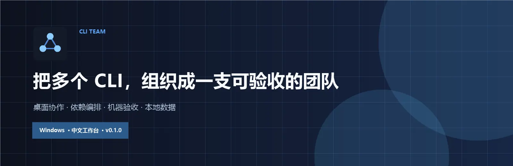
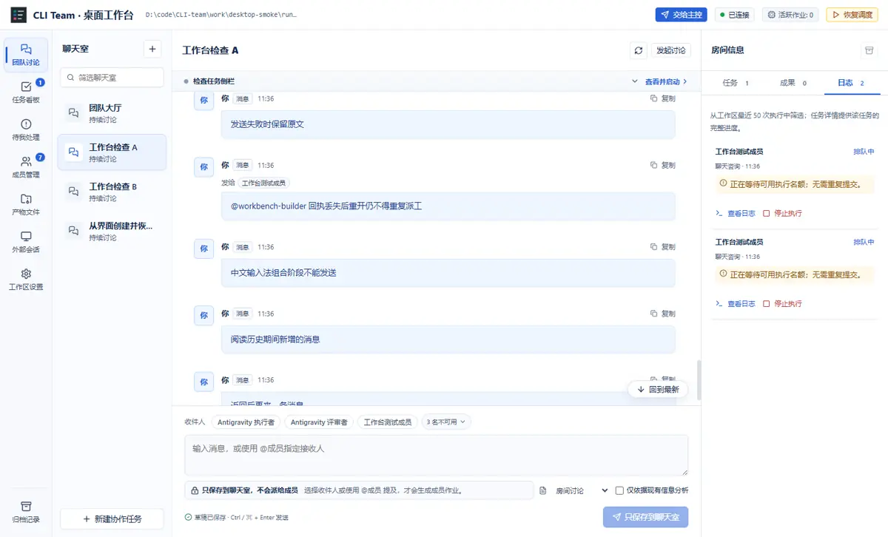
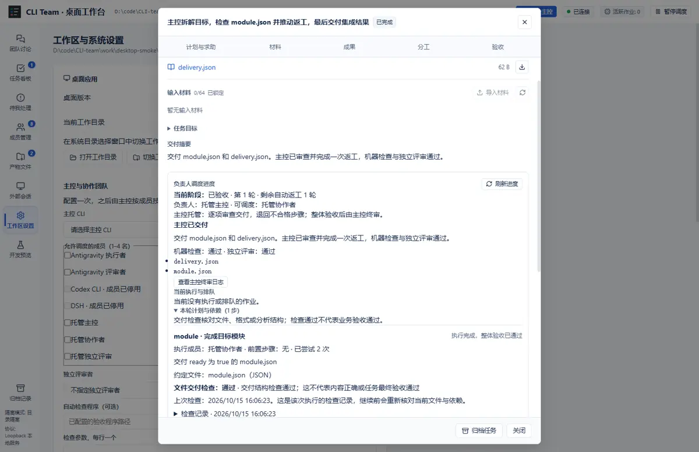

<p align="center">
  <a href="https://github.com/D2spacit0/CLI-team/releases/latest">
    
  </a>
</p>

<p align="center">
  <strong>Windows 中文桌面工作台</strong> · 多 CLI 协作 · 依赖编排 · 独立评审 · 本地交付证据
</p>

<p align="center">
  <a href="https://github.com/D2spacit0/CLI-team/releases/latest"></a>
  <a href="#快速开始"></a>
  
  
</p>

> 用一个目标调动多个官方 CLI。主控负责拆解、派工、返工与终审，工作台负责依赖编排、机器检查和证据留存。

## 一张图看懂

<p align="center">
  
</p>

## 你可以用它做什么

<table>
  <tr>
    <td width="33%" valign="top">
      <h3>把目标交给团队</h3>
      <p>选择一个主控和 1–4 名成员，描述目标后由主控拆解依赖、派发任务、回收结果并处理返工。</p>
    </td>
    <td width="33%" valign="top">
      <h3>在同一个房间协作</h3>
      <p>支持 <code>@成员</code>、多人讨论、求助、改派和会话续接。每个成员保留自己的原生 CLI 会话。</p>
    </td>
    <td width="33%" valign="top">
      <h3>凭证据交付</h3>
      <p>绑定文件与哈希，运行显式检查，再交给独立评审。模型说“完成了”不能替代机器验收。</p>
    </td>
  </tr>
  <tr>
    <td width="33%" valign="top">
      <h3>失败后接着做</h3>
      <p>草稿、材料、分工和验收意见自动保存。暂停、重启或断线后可以恢复有效步骤，不盲目重放旧任务。</p>
    </td>
    <td width="33%" valign="top">
      <h3>数据留在本机</h3>
      <p>本地回环服务、SQLite 状态和任务目录。工作台不复制官方 CLI 的登录凭据，也不把任务数据混入发行包。</p>
    </td>
    <td width="33%" valign="top">
      <h3>从桌面或 CLI 操作</h3>
      <p>既能在独立窗口里工作，也能通过项目 CLI、MCP 和 skill 接入自己的主控流程。</p>
    </td>
  </tr>
</table>

## 交付不是一句话

<p align="center">
  
</p>

```text
提交目标 → 主控拆解 → 成员执行 → 步骤审查
                              ↓
       交付 ← 主控终审 ← 独立评审 ← 机器检查
                              ↘
                          定向返工
```

任务只有在机器证据有效、产物版本未变化、独立评审和主控终审都通过时才自动交付。没有配置检查或缺少完整证据时，任务会停在待验收，交给用户确认。

## 快速开始

1. 从 [Releases](https://github.com/D2spacit0/CLI-team/releases/latest) 下载 `CLI-Team-v0.1.0-win32-x64-release.zip`。
2. 解压并保留整个 `CLI Team-win32-x64` 目录。
3. 运行 `CLI Team.exe`，在“工作区设置 → 主控与协作团队”中配置主控、成员和检查程序。
4. 安装并登录准备使用的官方 CLI，然后点击“交给主控”提交第一个目标。

桌面包已包含 Electron 和 Node.js 24，不需要另外安装 Node.js。程序目前未签名，Windows 可能显示 SmartScreen 提示。

<details>
<summary><strong>从源码运行与打包</strong></summary>

环境要求：Node.js 24+、Windows（用于桌面打包和桌面回归）。

```powershell
git clone https://github.com/D2spacit0/CLI-team.git
Set-Location CLI-team
npm ci
npm run build
npm start
```

生成 Windows 桌面程序：

```powershell
npm run dist:desktop
```

打包采用明确文件清单，不包含 `.team/`、`workspaces/`、`work/`、数据库、日志或官方 CLI 凭据。请保留完整程序目录，不能只移动 exe。

</details>

<details>
<summary><strong>支持哪些 CLI</strong></summary>

成员页面支持 Antigravity、DSH ACP、Claude Code、Gemini CLI、Codex CLI、OpenCode 和自定义适配器。

| 能力 | 说明 |
| --- | --- |
| 接入检测 | 只表示找到可执行入口，不代表已登录或真实模型调用成功 |
| 会话 | 同一成员可按房间续接自己的原生会话 |
| 模型 | 默认跟随官方客户端；也可在工作台明确选择 |
| 凭据 | 由官方客户端管理，工作台不复制登录 token |
| 自定义成员 | stdin 或 `{prompt}`、`{workspace}` 参数，返回约定 JSON |

DSH 还支持按房间续接、模型选择、取消执行，以及只读查看本机外部会话。只读挂载不会接管或重写原桌面会话。

</details>

<details>
<summary><strong>任务、材料与恢复</strong></summary>

**准备任务**

- 选择负责人、1–4 名成员和可选的独立评审者。
- 填写目标、完成标准、交付文件和可选材料。
- 可保存为待办；材料全部导入并核对后，再明确开始。
- 单文件最多 8 MiB，每任务最多 64 份、合计 32 MiB。

**执行与求助**

- 主控生成带依赖关系的步骤计划，服务校验成员权限和依赖后依次派发。
- 文件步骤可以约定相对路径与 `any`、`text` 或 `json` 格式。
- 分析步骤可以要求固定章节；缺文件、空文件、格式或章节不符都不能通过。
- 成员遇到具体问题时可以求助；负责人可只读答复，必要时咨询一名获授权成员。

**暂停、改派与恢复**

```powershell
node tools/team.mjs pause TASK_ID --note "调整分工后继续"
node tools/team.mjs progress TASK_ID
node tools/team.mjs assign TASK_ID --assignee OWNER_ID --members WORKER_A,WORKER_B --reviewer REVIEWER_ID
node tools/team.mjs start TASK_ID
```

暂停会等待成员进程和验收真正停止。改派保留文件、材料锁、历史记录和已用返工额度；只有用户明确继续后才重新规划。

**自动保存**

- 目标草稿、求助答复、返工意见和验收备注按任务与上下文保存。
- 断线或刷新后可以恢复，不会把草稿恢复成执行权限。
- 重试已送达的请求会找回原任务，不重复派工或通知。

</details>

<details>
<summary><strong>CLI 与 MCP 接入</strong></summary>

配置团队并提交目标：

```powershell
node tools/team.mjs configure-team --assignee OWNER_ID --members WORKER_A,WORKER_B --reviewer REVIEWER_ID --checks '["node","--test"]'
$goalRequestId = [guid]::NewGuid().ToString()
node tools/team.mjs submit --request-id $goalRequestId --objective "实现任务导出，支持按房间筛选，并交付测试与使用说明"
node tools/team.mjs progress TASK_ID
```

MCP 使用 stdio，示例配置：

```json
{
  "mcpServers": {
    "cli-team": {
      "command": "C:\\Program Files\\nodejs\\node.exe",
      "args": ["<仓库目录>\\tools\\mcp.mjs"]
    }
  }
}
```

常用 MCP 工具：`team_configure_controller`、`team_submit_objective`、`team_message`、`team_task`、`team_progress`、`team_answer_assistance`、`team_materials`、`team_evidence`、`team_decide`。

项目 skill 位于 [`skills/cli-team-controller/SKILL.md`](skills/cli-team-controller/SKILL.md)，不会自动安装到全局技能目录。

</details>

<details>
<summary><strong>开发、检查与项目结构</strong></summary>

```powershell
npm test
npm run check
npm run build
npm run smoke:desktop
npm run smoke:desktop -- --packaged
```

| 目录 | 内容 |
| --- | --- |
| `desktop/` | Electron 主进程、桌面桥接与窗口测试 |
| `server/` | 调度器、适配器、API、权限、验收与持久化 |
| `ui/` | React 中文工作台 |
| `tools/` | 主控 CLI、MCP、打包与桌面检查 |
| `tests/` | 状态机、进程、接口、材料和桌面回归 |
| `.team/` | 本机运行数据与日志，不进版本控制 |
| `workspaces/` | 任务目录与真实交付产物，不进版本控制 |

贡献前请阅读 [CONTRIBUTING.md](CONTRIBUTING.md)。确定性测试不调用付费模型；真实 CLI 验证单独进行。

</details>

## 安全边界

- 本地服务只绑定 `127.0.0.1`，并使用随机桌面令牌或本地主控凭据。
- 桌面渲染器启用沙箱，不提供 Node 权限；普通浏览器不能打开工作台。
- 默认不使用绕过审批的 CLI 参数，权限拒绝会阻止成功。
- 目录隔离和文件哈希不是操作系统沙箱。对不可信代码仍需额外隔离。
- 验收程序本身可以运行代码，必须由用户或主控明确选择。
- `.team/` 包含本地凭据、数据库和日志，不应提交或公开分享。
- 存在本地启动暂停标记时，桌面程序不会启动服务或执行成员任务。

## 已知限制

- 当前桌面发行包仅提供 Windows x64。
- 程序未进行代码签名，Windows 可能显示 SmartScreen 提示。
- 官方 CLI 需要自行安装、登录并承担相应额度。
- 当前 Codex 对话不会因为本地服务运行而全天候在线，也没有安装开机自启或定时唤醒。
- 模型结果和成员报告都视为未验证声明；验收依赖机器证据、独立评审和用户规则。

---

<p align="center">
  <sub>本地优先 · 证据驱动 · 中文桌面工作台</sub>
</p>