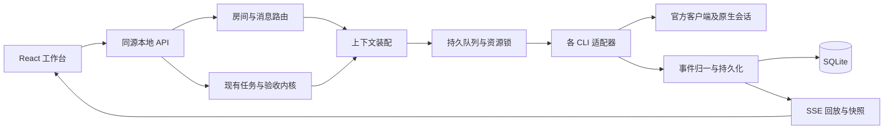

# CLI Team 运行与聊天室接口合同

版本：2026-10-12，实施提案。**第 1 节描述现有接口；其余 v2 接口和类型尚未实现。** 前端不得把新增字段假定为当前后端已经返回。

与[工作台设计](2026-10-12-workbench-design.md)配套。目标是让 Gemini 可以先迁移已有界面，再按稳定合同接入原生会话、实时输出和可追踪的成员交接。

## 1. 现有接口：第一批可以直接使用

事实源：[server/app.mjs](../../server/app.mjs)、[server/service.mjs](../../server/service.mjs)、[ui/api.ts](../../ui/api.ts)、[ui/types.ts](../../ui/types.ts)。

| 功能 | 现有接口 | 关键语义 |
| --- | --- | --- |
| 初始数据 | `GET /api/bootstrap?archived=1` | members / rooms / tasks / runs / artifacts / meetings；runs 最近 50，artifacts 最近 300，不是完整历史 |
| 房间消息 | `GET /api/rooms/:id/messages` | 默认最近 100 条；没有分页参数合同 |
| 创建房间 | `POST /api/rooms` `{name}` | 仅创建 team 类型房间，没有成员配置 |
| 发送消息 | `POST /api/rooms/:id/messages` | `{body,recipientIds,analysisOnly,taskId?}`；正文 @handle 与 recipientIds 合并，最多 4 人 |
| 解除会话映射 | `POST /api/rooms/:id/members/:memberId/reset` | `{confirm:true,taskId?}`；成员停稳后解除映射，原 CLI 会话不删除 |
| 检测/保存成员 | `POST /api/members/discover`，`POST /api/members`，`PATCH /api/members/:id` | detected/ready 主要证明入口存在，不证明登录与模型可用 |
| 发起讨论 | `POST /api/meetings` | `{roomId,objective,memberIds}`；2–4 人，independent → challenge → synthesis |
| 创建任务 | `POST /api/tasks` | 按既有 schema；`creationRequestId` 保证重试复用，`start:false` 用于准备材料 |
| 配置主控团队 | `PATCH /api/settings` `{managedTeam}` | ownerId / workerIds / reviewerId / verification / autoDeliver；只用于新目标，可设 null 清除配置 |
| 交给主控 | `POST /api/requests` `{requestId,objective,title?,roomId?}` | requestId 为 UUID；自动创建并启动托管任务，重试返回原任务而不重启；不同输入复用 ID 返回 409 |
| 任务进度 | `GET /api/tasks/:id/progress` | currentRuns / waitReason / coordination / assistance / resume / totalRuns / omittedRuns |
| 准备后首次启动 | `POST /api/tasks/:id/start` `{expectedState:"unstarted"}` | 只启动未开始的待办，防止重试误变继续 |
| 继续既有任务 | `POST /api/tasks/:id/start` `{}` | 服务决定规划、局部恢复或其他阶段；不等于恢复某原生 CLI 进程 |
| 暂停/取消任务 | `POST /api/tasks/:id/pause`，`POST /api/tasks/:id/cancel` | 暂停/取消后停稳；界面不能提前允许改派 |
| 改派 | `POST /api/tasks/:id/reassign` | `{assigneeId,reviewerId,note,participantIds?}`；服务验证角色和当前运行 |
| 答复业务求助 | `POST /api/tasks/:id/assistance/:helpId/answer` | `{answer}`；保存答复与继续执行是分离动作 |
| 返工 | `POST /api/tasks/:id/revise` | `{feedback}`；当前为字符串反馈 |
| 人工接受 | `POST /api/tasks/:id/accept` | `{note,acknowledgeMissingGate}`；服务重新核验 gate / reviewer / 产物版本 |
| 输入材料 | `GET/POST /api/tasks/:id/materials`，`DELETE /api/tasks/:id/materials/:materialId` | name / contentBase64 / sha256；首次运行后锁定 |
| 执行详情/取消 | `GET /api/runs/:id`，`POST /api/runs/:id/cancel` | 详情返回 run / result / logTail；不是原生结构化事件流 |
| 成果预览/下载 | `GET /api/artifacts/:id/preview`，`GET /api/artifacts/:id` | 受服务允许的格式和路径约束，不支持任意路径访问 |
| 草稿 | `POST /api/ui-drafts/read`，`PUT/DELETE /api/ui-drafts` | workspace / scope / revision，复用 taskDrafts；已支持 `{kind:"room-message",roomId}` |
| 全局设置 | `PATCH /api/settings` | paused / proxy / maxParallel / maxHops / repairLimit / runTimeoutMinutes / managedTeam |
| 归档/恢复 | `POST /api/tasks/:id/archive或restore`，房间同类接口 | 运行中的项目不能直接归档；团队大厅不能归档 |
| 更新通知 | `GET /api/events` | `{type,revision,payload}`，无 SSE id / 回放；收到后重新读取相关数据 |

桌面保持当前 `cliTeamDesktop.getInfo/selectWorkspace/openWorkspace/onBeforeLeave`。没有“任意执行命令”“任意文件打开”的桌面桥接口，Gemini 不应自行假造。

`/api/control/*` 是本地主控专用，不作为普通前端待处理数据源，不把主控凭据传给渲染页。

### 第一阶段的状态映射

| 现有字段 | 展示 |
| --- | --- |
| Task.status = backlog | 待准备/待开始，按是否完成准备补充说明 |
| running | 执行中；阶段由 coordination / currentRuns 决定 |
| review | 待验收，同时显示独立评审结果，不简单写“评审通过” |
| blocked | 已暂停或受阻，结合当前原因显示；不能只看一个枚举 |
| done / cancelled | 已完成 / 已取消 |
| Run.status = succeeded | 本次执行已结束；不推导任务已验收 |
| Run.status = interrupted | 执行已中断，保留部分结果 |
| Gate.status = not_configured / pending / passed / failed / stale | 未配置 / 检查中 / 通过 / 失败 / 已失效 |

服务返回的 `publicRun` 可能将后续验收中的 run 暂时显示为 running，或把交付结构失败显示为 blocked。前端尊重这一投影，不从 exitCode 改写。

托管任务使用 `managed:true` 和既有 `executionMode:delegated`。`coordination.phase:checking` 表示主控检查成员步骤，步骤状态为 `reviewing`、作业阶段为 `step_review`；`delivering` 与 `final_review` 表示主控整体终审。步骤的 `ownerReview` 与 `outputCheck` 分开记录，`delivery.status:ready|delivered` 保存终审、机器证据及成果版本。自动交付仍经过原接受入口的验证。旧 direct / delegated 任务保留原行为。此增量已经实现，不代表下文 v2 原生传输合同已实现。

## 2. 新领域边界



建议新模块位于 `server/engines/`、`server/rooms/`、`server/events/`。现有 `server/runtime.mjs` 保留原职责，不因为名字接近就覆盖。

### 标识与上下文范围

- `workspaceId`：服务数据范围的稳定 ID，不能用页面标签当工作区。
- `roomId`：用户可见话题容器。
- `memberId`：具体执行身份，不能用 provider 代替。两个 Codex 成员仍是两个身份。
- `taskId / planId / stepKey`：业务调度和恢复边界。
- `runId`：一次调度运行；重试产生新运行，并引用原运行。
- `messageId / deliveryId`：一条可见消息，以及对一个收件人的投递。
- `nativeSessionId / nativeTurnId`：由官方 CLI 返回的引用；并非 roomId，也不是接管授权。
- `correlationId / causationId`：关联整个交接链及直接触发它的事件/消息。

建议会话键：`workspaceId + roomId + taskId或room范围 + memberId + 执行角色 + 配置版本`。规划、实现、咨询和独立评审使用不同范围；任务 A 不复用任务 B 的对话。会话键的最终策略需覆盖现有 service 的角色后缀兼容测试。

跨成员传递的是有来源的上下文包：原目标、相关问题、被选择的消息、依赖交付及其 hash、已有机器证据、尚未解决的事项。成员结论注明为未验证陈述。保存 contextManifest，列出 includedMessageIds / artifactRefs / omittedCount / 是否摘要化；不承诺完整共享所有原生历史。

## 3. 引擎接口与能力

先以小型接口封装现有能力，再逐项增加双向传输。不要为所有客户端强行套同一种协议。

```ts
type Support = 'supported' | 'unsupported' | 'unknown';

interface EngineCapabilities {
  memberId: string;
  provider: string;
  configRevision: number;
  checkedAt: string | null;
  executable: 'found' | 'missing' | 'unknown';
  version: string | null;
  login: 'ready' | 'required' | 'unknown';
  transport: 'stdio-json' | 'app-server' | 'acp' | 'local-service' | 'custom';
  resume: Support;
  textStream: Support;
  tools: Support;
  cancel: Support;
  images: Support;
  userQuestions: Support;
  toolApproval: Support;
  planApproval: Support;
  filePolicy: 'enforced' | 'advisory' | 'unknown';
  permissionModes: Array<{ id: string; label: string; guarantees: string[] }>;
  modelOptions: Array<{ id: string; label: string; source: 'runtime' | 'manual' }>;
  limitations: string[];
}

interface EngineAdapter {
  probe(input: ProbeInput): Promise<EngineCapabilities>;
  startTurn(input: TurnInput, sink: EventSink, signal: AbortSignal): Promise<TurnResult>;
  respond(request: NativeResponse): Promise<ResponseReceipt>;
  cancel(runId: string): Promise<CancelReceipt>;
}
```

ProbeInput / TurnInput / EventSink 等是后端内部接口名，实施时按本文语义定义；不属于前端可以提交任意参数的 RPC。

能力检测优先使用官方版本、帮助或协议初始化，输出采用字段白名单；不读取或输出凭据。登录没有可靠状态来源就保持 unknown。切换配置使能力结果过期；正在运行的任务保留启动时的配置快照。

| CLI | 建议迁移路径 | 不能假定的能力 |
| --- | --- | --- |
| Claude | 现有单次 stream-json → 支持 control protocol 的双向 stdio | 并非所有工具请求都能回送；需实际协议回归 |
| Codex | 保留 exec 基线 → 本地 app-server 适配 | exec 支持不意味着原生提问/计划审批可用 |
| Gemini | 保留当前 CLI 路径 → 核验后使用 Gemini ACP | 选项、session/load、权限模式随版本核验 |
| OpenCode | 保留 run 路径 → 托管本地 serve + SSE | 不能照搬参考的自动应答权限策略 |
| DSH | 先继续已有 ACP，归一事件与请求 | 外部桌面会话保持观察；宿主会话接管另行设计 |
| AGY | 修齐 init/step_update/result 的已知格式及分块正文 | 结束事件可能不含全文；缺失回执不得当成功 |
| custom | 明确受支持的输入和输出协议 | 自定义程序存在不等于支持会话恢复、审批或任务报告 |

进程始终使用可执行程序和参数数组、`shell:false`、`windowsHide:true`、子进程范围代理。服务只绑定 loopback。适配器声明的 plan/edit 必须注明实际保证，禁止 bypass/yolo 类参数。

### 普通聊天与任务报告分开

- 普通聊天允许显示合法正文，即使 CLI 没有返回 agentReport JSON；无法确认完成时保留部分正文和状态。
- 任务规划、执行和评审继续要求业务结构化报告。没有报告就不能推进阶段。
- 工具输出、模型总结、结构检查、机器检查分别记录来源。
- 协议层只确认会话/运行发生了什么；任务内核决定是否满足下一步条件；最终接受仍由现有 acceptTask 判断。

这需要后端显式实施。第一阶段仍按现有所有运行要求 report 的服务行为展示，不在前端绕过报告校验。

## 4. 拟新增的前端 DTO

以下类型是 v2 提案，不替换当前 ui/types.ts。

```ts
interface RoomView {
  id: string;
  revision: number;
  name: string;
  mode: 'direct' | 'discussion' | 'work';
  membershipPolicy: 'explicit' | 'legacy-open';
  memberIds: string[];
  coordinatorId: string | null;
  taskIds: string[];
  archivedAt: string | null;
}

interface DeliveryView {
  id: string;
  revision: number;
  messageId: string;
  recipientId: string;
  status: 'queued' | 'submitted' | 'replied' | 'failed' | 'cancelled' | 'uncertain';
  runId: string | null;
  replyMessageId: string | null;
  waitReason: string | null;
  errorCode: string | null;
}

interface MessageView {
  id: string;
  revision: number;
  roomId: string;
  taskId: string | null;
  senderId: string;
  kind: 'user' | 'agent' | 'system' | 'decision';
  body: string;
  recipientIds: string[];
  replyToMessageId: string | null;
  runId: string | null;
  correlationId: string;
  createdAt: string;
  deliveries: DeliveryView[];
}

interface RunView {
  id: string;
  revision: number;
  roomId: string;
  taskId: string | null;
  memberId: string;
  state: 'queued' | 'starting' | 'running' | 'waiting_input' | 'stopping'
       | 'completed' | 'failed' | 'cancelled' | 'interrupted';
  completion: 'pending' | 'confirmed' | 'incomplete' | 'unknown';
  nativeSessionId: string | null;
  nativeTurnId: string | null;
  requestedModel: string | null;
  reportedModel: string | null;
  reportStatus: 'not_required' | 'pending' | 'valid' | 'invalid';
  error: { code: string; message: string; retryable: boolean } | null;
}
```

`submitted` 表示传输层已确认提交上下文，不表示模型“读懂”或看见所有历史。只有进程启动而没有提交确认时继续显示运行事实，不虚构已读。

`completed` 只描述一次运行结束；其任务可能仍在机器检查、独立评审或待验收。UI 不根据 RunView 修改 Task.status。

### 新消息请求示例

```json
{
  "clientMessageId": "2432e7b4-6ee2-4fe2-9e5e-42a5353bd6a7",
  "expectedRoomRevision": 4,
  "body": "请核对错误码字段，再答复页面成员。",
  "routing": { "mode": "members", "recipientIds": ["member-api"] },
  "mentions": [],
  "taskId": "task-homepage",
  "replyToMessageId": "message-question"
}
```

规则：

1. routing.mode 为 record / members / coordinator；record 永不派工。members 至少 1 人，合并结构化 mentions 后最多 4 人。coordinator 使用房间当前配置并校验 revision。
2. mentions 为 `{memberId,start,end}`，指向正文中由选人操作产生的片段；范围使用 JavaScript UTF-16 下标并验证文本与成员 handle 一致。粘贴正文、代码引用不会仅凭 @ 自动派工。
3. taskId 必须属于该房间；task 参与者与阶段授权继续校验，不能靠房间成员身份扩权。
4. 校验收件人和队列容量后，在同一事务中保存 message + 每个 delivery + queued run + 事件。验证失败整体拒绝；启动后的失败按收件人分别更新。
5. `(workspaceId,roomId,clientMessageId)` 唯一。同键同内容返回原结果；同键异内容 409。首次 201，幂等重放 200。
6. 不可因 HTTP 超时生成新 ID 自动重发。先用原 ID 查询/重试拿原回执。原生提交结果不明时进入 uncertain，核实会话后才能新建运行。
7. 修改待发内容不回写已保存消息。全部投递均未提交时可取消并恢复为草稿；已有收件人收到时，新内容作为新消息并关联原消息。

## 5. v2 接口清单与分期

| 批次 | 拟新增接口 | 响应与边界 |
| --- | --- | --- |
| B | `GET /api/v2/capabilities` | schemaVersion、features、每成员 EngineCapabilities；未实现功能 false |
| B | `GET /api/v2/workbench?roomId=&taskId=` | 原子读取选中上下文快照及 cursor；包含当前活动运行，不能只截最近 50 条 |
| B | `GET /api/v2/events?after=` | 持久事件回放，随后实时推送；支持 Last-Event-ID |
| B | `GET /api/v2/runs/:id/snapshot` | RunView、输出块及各块版本、有效原生请求、最后 cursor |
| B | `POST /api/v2/members/:id/probe` | 有界能力检测；不隐式发起模型任务或登录 |
| B | `POST /api/v2/native-requests/:id/respond` | `{clientActionId,expectedRevision,decision}`；有限动作，不能透传任意原生 RPC |
| C | `POST /api/v2/rooms` | name / mode / memberIds / coordinatorId / clientRequestId；创建后不自动运行 |
| C | `PATCH /api/v2/rooms/:id` | expectedRevision 及允许变更的房间字段；活动成员移除等冲突返回 409 |
| C | `POST /api/v2/rooms/:id/messages` | 上述新消息请求；返回 message / deliveries / cursor |
| C | `GET /api/v2/rooms/:id/messages/by-client-id/:clientMessageId` | 响应不明后的对账；404 才表示没有该持久消息 |
| C | `POST /api/v2/deliveries/:id/cancel` | expectedRevision / clientActionId；只撤回尚未提交的投递 |
| C | 聊天草稿扩展材料引用 | 基础 `{kind:"room-message",roomId}` 已实现；`taskId` 当前属于 values，不能放入 scope。材料引用仍为提案，不存授权决定 |
| D | `GET /api/v2/rooms/:id/messages?before=&limit=` | items 按显示顺序升序、nextBeforeCursor / hasMore；cursor 不由前端构造 |
| D | `GET /api/v2/attention?cursor=` | 按用户可见范围分页，含 reason / action / 当前实体版本 |
| D | `GET /api/v2/tasks/:id/resume-preview` | keep / rerun / reasons / planId / evidenceRevision / previewToken |
| D | `POST /api/v2/tasks/:id/continue` | clientActionId / previewToken；执行前重算，变化返回 409 与新预览 |
| D | `POST /api/v2/tasks/:id/revision-feedback` | feedback + 文件/片段/hash 引用；不改变已有字符串返工 API |

`features` 示例键：nativeEvents、nativeQuestions、nativeToolApproval、roomMembership、messageDeliveries、roomDrafts、messagePagination、attentionQuery、resumePreview。全局 feature 和成员 capability 都允许时才提供相关操作。

v2 capabilities 返回 404 表示当前服务没有新版接口，切换 legacy adapter；网络失败、401、403 或 500 不降级成“功能不存在”。不要用探测失败触发一轮未知 API 写入。

## 6. 可靠事件合同

```ts
interface WorkbenchEvent {
  schemaVersion: 2;
  seq: number;
  type: string;
  occurredAt: string;
  workspaceId: string;
  roomId: string | null;
  taskId: string | null;
  runId: string | null;
  correlationId: string | null;
  payload: unknown;
}
```

全局 seq 来自持久事件序列；实体 revision 表示实体版本；原生 requestId 只在其运行范围有效。三者不互换。

### 快照与重连

1. 在一致读事务中取得 workbench snapshot 和 cursor C。
2. 订阅 after=C，先按 seq 回放，再接实时事件，避免读取快照与订阅之间漏更新。
3. SSE 每个事件设置 `id: seq`。服务提供至少一次投递；前端按 seq 去重，不假定网络只送一次。
4. 若保留期不足，服务明确返回 `EVENT_CURSOR_EXPIRED` 或 `resync_required`，前端重取快照；不无限重连旧游标。
5. 心跳不改变实体版本。断连不停止后端任务，也不重发用户动作。
6. 页面重载后先同步活动运行和有效请求，再恢复位置和草稿。过期审批按钮不得复活。
7. 快照/事件跨工作区不匹配时丢弃并重新加载，不将旧工作区事件应用到新页。

### 最小事件集合

| 事件 | payload 语义 |
| --- | --- |
| message.created / message.updated | MessageView 或可定位的实体版本 |
| delivery.updated | DeliveryView |
| run.state.changed | RunView |
| run.block.updated | blockId / version / op / text或delta / kind / toolCallId |
| native.request.opened / settled | 受控请求的显示模型及有效性 |
| task.updated / task.coordination.updated | 当前任务及计划版本 |
| assistance.updated | 当前 helpId、计划及处理状态 |
| artifact.recorded / verification.completed | 成果/机器证据引用及版本，不包含秘密 |
| session.bound / session.invalidated | 成员会话范围与可显示原因 |

输出块规则：

- op 为 append 或 replace；相同 blockId 的 version 单调递增。小于等于已知版本的事件忽略；append 出现版本缺口时重取 run snapshot。
- 原生最终全文用 replace 更新对应块，不在增量正文后再追加一遍全文。
- 工具调用使用原生 toolCallId；没有 ID 时由适配器在该 run 内生成稳定 ID，不按工具名称合并。
- 原生大量细碎 delta 可按 50–100ms 批量持久化和推送；终结前刷完缓冲。正文截断或保留上限必须显式标记。
- 未识别协议帧只进脱敏诊断，不能按模型文本自动转成控制事件。
- 错误/警告/原生重试分别归一；一次模型尝试失败不立即断言整个 CLI 结束。

## 7. 原生请求与生命周期

```ts
interface NativeRequestView {
  id: string;
  revision: number;
  runId: string;
  memberId: string;
  kind: 'question' | 'tool_permission' | 'plan_approval';
  title: string;
  description: string;
  state: 'pending' | 'responding' | 'resolved' | 'expired' | 'cancelled';
  allowedDecisions: Array<{ id: string; label: string }>;
  scopeSummary: string;
  planHash: string | null;
  expiresAt: string | null;
}
```

响应中的 decision 必须匹配该请求的允许选择；问题答案只能填写既定问题键；计划批准必须匹配完整计划的版本/hash。具体原生上下文、句柄和权限 token 只保存在后端。

一条 response 按 clientActionId 去重。提交时原子校验请求状态与版本；过期/已取消/已被替代返回 409。写入本地决定不立即标为原生已接受：收到传输确认后才 resolved；传输不明显示 responding/诊断并对账，不能重复放行。

运行结束、取消、宿主退出时相关挂起请求失效。跨重启只有适配器能够从原生会话重新确认同一有效请求时才恢复 pending，否则过期。计划草稿没有批准按钮。

## 8. 路由、排队和恢复约束

- 房间成员名单是路由范围，不是文件权限；任务仍使用自己的负责人、协作者和评审名单。
- 普通交接继续单次一名收件人、禁止自交接、保留 trace 与 hop 上限；不得把成员正文中的 @ 自动当 handoff。
- 负责人任务派工必须通过既有计划 schema、成员白名单、依赖无环、文件生产者唯一性校验。
- 同一成员最多一个活动运行；共享任务目录维持当前读写互斥；任务内 delegated 步骤第一期继续顺序执行。
- 排队原因来自调度器：全局暂停、成员忙、并发名额、目录占用。前端不另写一套推测。
- 业务求助绑定 taskId / planId / stepKey / runId；晚到回答不能恢复旧计划。
- 进程“已请求停止”与“已经退出”分开。停稳前不能释放写锁或允许改派。
- 重启不回放已取消或提交不明的运行；先对账。业务请求幂等不等于外部文件副作用天然 exactly-once。
- 当前检查点只证明有效交付可复用，不表示整个文件系统、CLI 记忆或外部副作用能回滚。

## 9. 错误合同

v2 错误统一为 `{error:{code,message,retryable,details?}}`；details 仅包含允许显示的实体 ID、状态与范围说明。旧版 `{error:string}` 由 legacy adapter 兼容。

| code | HTTP | UI 行为 |
| --- | --- | --- |
| MEMBER_UNAVAILABLE | 409 | 保留输入，指向成员修复；不悄悄替换收件人 |
| CAPABILITY_UNSUPPORTED | 422 | 禁止该动作，解释当前接入能力 |
| ROOM_REVISION_CONFLICT | 409 | 重新读取名单/负责人，用户核对原目标 |
| IDEMPOTENCY_CONFLICT | 409 | 保留本地内容，显示同 ID 内容不一致 |
| QUEUE_FULL | 429 | 未接受则保持草稿，提示稍后重试 |
| SESSION_INVALID | 409 | 核实原生会话；已提交状态未知时不自动新开重发 |
| NATIVE_SUBMISSION_UNKNOWN | 409 | 显示“提交结果待确认”，提供诊断/对账 |
| REQUEST_EXPIRED | 409 | 过期卡禁用，刷新当前请求 |
| EVENT_CURSOR_EXPIRED | 409 | 重取快照并订阅新游标 |
| RESUME_PREVIEW_STALE | 409 | 展示新的复用/重做范围，不沿用旧预览 |
| PROTOCOL_INCOMPLETE | 502 | 保留部分正文，说明缺少完成确认 |
| TASK_GATE_BLOCKED | 409 | 定位具体机器检查/评审/版本问题 |

## 10. 迁移与兼容

1. **添加能力入口，旧功能不迁移数据也可运行。** 新 UI 通过 legacy adapter 复用当前 DTO。
2. **新字段增量引入。** 现有 rooms/tasks/messages/runs ID 保持不变。旧消息缺少 replyTo / delivery 时显示“历史未记录”，不补造送达事实。
3. **老房间明确 legacy-open。** 不根据历史 @ 或 sender 自动推导授权成员。用户以后设置明确名单时变为 explicit；该设置不改变旧任务授权。
4. **旧会话映射保留兼容读取。** 新范围生效前验证 cwd、member、任务和角色；不能只凭会话 ID 恢复到不同目录。
5. **已有草稿不丢。** 新 room-message scope 与已有 scope 并存；迁移不恢复执行/接受授权，也不把材料清单当文件内容。
6. **后端与桌面格式升级需可回退。** 实施时先作 SQLite 一致性备份，再进行带 schemaVersion 的迁移；不能只拷贝正在使用的主数据库文件而忽略 WAL。旧 UI 不理解的新记录以兼容投影读取。
7. **最终验证才切换默认界面。** 新工作台先使用可切回入口；旧界面退场以真实工作流回归完成为条件，不以画面已完成为条件。

## 11. 关键架构决策（ADR，状态均为 Proposed）

| ADR | 背景与决定 | 代价 / 替代方案 |
| --- | --- | --- |
| 001 保留本地技术栈与任务内核 | Node 24+ / ESM / Express / SQLite / React / TS / Electron；重构工作台和接入边界 | 过渡期有 legacy/v2 两层映射；整仓换 Tauri 会增加迁移与回归范围，收益不足以抵消 |
| 002 房间与原生会话分离 | 房间承载协作事实，每成员按任务/角色绑定原生会话 | 需要上下文清单和会话失效处理；共享单个原生会话会混淆身份、权限和评审独立性 |
| 003 后端负责路由与事件 | 持久化后派工；前端只提交意图并投影事实 | 增加事件与投递数据；前端自动串调用在窗口关闭/重连时难保证一致 |
| 004 保留分层验收 | 运行、业务报告、结构检查、机器证据、独立评审、人工接受分别记录 | UI 比单个绿色 done 更复杂；用退出码统一判成功会削弱已具备的验收能力 |
| 005 能力决定操作 | 根据版本和实际传输开放问题/审批/恢复，未知明确显示 | 每家 CLI 需要独立回归；统一展示所有按钮会承诺不具备的能力 |

这些决策供用户与实施者在具体改造前评审；不要求为阅读文档或实现已授权的可逆界面工作另开审批流程。

## 12. 验证范围

优先验证会造成错误派工或错误验收的行为：幂等发送、原生提交不明、断线回放、并发取消、过期审批、跨任务会话隔离、部分交付恢复、产物变化导致 gate 失效。

每个适配器至少验证：版本探测、一次正文、多轮恢复、工具事件、无完成回执、退出错误、超时与取消、已支持的原生问题/权限往返。真实模型测试使用项目内独立目录、最小任务和已授权范围；样本或固定执行器通过不能替代真实 CLI 结果。

性能目标是实施验收目标，尚未实测：读取 100 条近期消息可交互不超过 1 秒；20 个任务切换不阻塞输入；活动输出按批次刷新；长历史按页取回，不把整段日志放入 bootstrap。需要在实际桌面版本上记录测量结果。
