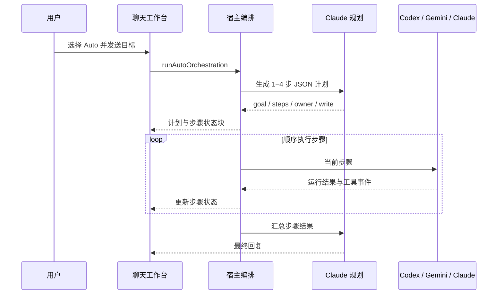

# CLI 接入与聊天室源码研究

日期：2026-10-12。范围：接续上一会话，完成参考项目研究及前端规划，未修改产品源码。

建议采用 **CCGUI 的引擎适配层、multi-cli-studio 的会话工作台结构，加上 CLI Team 已有的任务调度与验收内核**。前端围绕聊天室重新组织，后端补齐原生运行事件与消息送达记录。

## 1. 证据范围

| 项目 | 本次读取的固定版本 | 取证方式 |
| --- | --- | --- |
| desktop-cc-gui | `6100b177b1e913c45ca108dc0746f161f11b6cb0` | 复用上一轮下载的源码压缩包，以 GitHub ZIP 的提交注释确认版本 |
| multi-cli-studio | `ad4bc1ef12fac62f1017d3b20dd3352b97b83ee1` | 本轮查询 main 提交并下载该提交的源码，核对 ZIP 提交注释 |
| CLI Team | 当前仓库源码 | 阅读实际接口、适配器、调度、类型和桌面桥接 |

索引：[source-index.json](../../work/frontend-design-20261012/source-index.json)。以下外部源码链接均固定到上述提交，不代表未来版本。没有安装或运行参考项目，没有调用真实模型；截图观察只证明布局。

CCGUI 的该版本引擎注册表列出 Claude、Kimi、Grok、Codex、Pi、OMP、DSH、AGY、OpenCode、Qoder、Qoder CN、MiniMax，**没有独立 Gemini CLI 适配器**。Gemini CLI 的原生接入参考来自 multi-cli-studio；模型名出现 Gemini 不能证明接入了 Gemini CLI。[注册表](https://github.com/zhukunpenglinyutong/desktop-cc-gui/blob/6100b177b1e913c45ca108dc0746f161f11b6cb0/src-tauri/src/config.rs#L11)

## 2. CCGUI：每个 CLI 对外兑现相同的运行能力

### 2.1 接入的核心结构

`SendRequest → Engine → Transport → EngineEvent → 前端会话状态`。

- `SendRequest` 携带工作目录、原生会话 ID、提示词、模型、权限及附件等调用信息。
- `Engine` 负责构建参数、解析原生输出、声明能力、选择传输方式。
- `Transport::Child` 表示启动进程并读 stdout；`Transport::Own` 表示由专门驱动管理 app-server、ACP 或宿主连接。
- `EngineInfo` 将图片、模型推理强度、工具约束、权限和计划审批能力提供给前端。
- `ProcessRegistry` 将一次运行和原生会话别名关联到同一个活动实体，提供停止、提问应答和计划审批的返回通道。

证据：[Engine 合同](https://github.com/zhukunpenglinyutong/desktop-cc-gui/blob/6100b177b1e913c45ca108dc0746f161f11b6cb0/src-tauri/src/engine/mod.rs#L129)、[能力投影](https://github.com/zhukunpenglinyutong/desktop-cc-gui/blob/6100b177b1e913c45ca108dc0746f161f11b6cb0/src-tauri/src/engine/mod.rs#L368)、[运行注册表](https://github.com/zhukunpenglinyutong/desktop-cc-gui/blob/6100b177b1e913c45ca108dc0746f161f11b6cb0/src-tauri/src/engine/registry.rs#L20)。

对 CLI Team 的启发：成员配置不应只有“命令存在”。需要分别显示客户端可用性、能力探测结果、原生会话绑定和当前运行状态；视图不负责拼接每家 CLI 的参数。

### 2.2 不同 CLI 的实际传输

| 客户端 | 该参考版本中的接法 | 需要学到的部分 |
| --- | --- | --- |
| Claude | `-p` 配合输入/输出 stream-json、partial messages、stdio 控制协议；stdin 保持打开；支持 resume | 提示输入与控制回复共用长开的管道；工具调用按 ID 关联 |
| Codex | 本地使用 app-server；thread/start 或 resume 后执行 turn；另一条环境路径保留 exec 子进程 | 会话与单次运行分开；普通 exec 不具备同样的用户提问通道 |
| OpenCode | 托管 serve，创建/恢复服务端会话，prompt_async，订阅 SSE | 原生服务事件完整性比读取单次 run 的尾部文本更重要 |
| DSH | 宿主会话和 mux 流，专用驱动投影事件 | 已有宿主和自建运行必须区分所有权，不能擅自接管外部会话 |
| Kimi / Qoder 等 | 专用 ACP 驱动 | 初始化、会话、通知、权限应答及取消需要单独实现 |
| Antigravity / AGY | `--output-format stream-json`，明确 add-dir / conversation，处理 init / step_update / result | 逐段正文和终结事件分开；提示参数、事件嵌套与原生会话 ID 需要版本化兼容 |

证据：[Claude](https://github.com/zhukunpenglinyutong/desktop-cc-gui/blob/6100b177b1e913c45ca108dc0746f161f11b6cb0/src-tauri/src/engine/claude.rs#L71)、[Codex](https://github.com/zhukunpenglinyutong/desktop-cc-gui/blob/6100b177b1e913c45ca108dc0746f161f11b6cb0/src-tauri/src/engine/codex.rs#L269)、[OpenCode](https://github.com/zhukunpenglinyutong/desktop-cc-gui/blob/6100b177b1e913c45ca108dc0746f161f11b6cb0/src-tauri/src/engine/opencode.rs#L1)、[DSH](https://github.com/zhukunpenglinyutong/desktop-cc-gui/blob/6100b177b1e913c45ca108dc0746f161f11b6cb0/src-tauri/src/engine/dsh.rs#L1)、[Kimi ACP](https://github.com/zhukunpenglinyutong/desktop-cc-gui/blob/6100b177b1e913c45ca108dc0746f161f11b6cb0/src-tauri/src/engine/kimi_acp.rs#L61)、[AGY](https://github.com/zhukunpenglinyutong/desktop-cc-gui/blob/6100b177b1e913c45ca108dc0746f161f11b6cb0/src-tauri/src/engine/agy.rs#L63)。表中是源码机制，未在本机逐项验证兼容性。

### 2.3 统一事件让前端理解正在发生什么

`EngineEvent` 覆盖正文增量、工具块、会话 ID、用量、错误、重试、权限拒绝、用户问题、计划草稿、完整计划审批、上下文压缩和最终结束。工具块带 `tool_call_id`，避免两个同名工具交错输出时被合并。

尤其值得保留的区别：

1. 一次模型尝试结束、CLI 内部重试和整个运行结束是不同事件。
2. 计划草稿不可批准；完整计划按版本批准；运行结束后未处理的请求过期。
3. 启动时请求的模型与响应报告的实际模型分开，未报告的一侧保持未知。
4. 请求的原生返回上下文留在后端，前端只提交有限的选择。

证据：[事件定义](https://github.com/zhukunpenglinyutong/desktop-cc-gui/blob/6100b177b1e913c45ca108dc0746f161f11b6cb0/src-tauri/src/engine/events.rs#L9)、[前端提前到达事件缓存](https://github.com/zhukunpenglinyutong/desktop-cc-gui/blob/6100b177b1e913c45ca108dc0746f161f11b6cb0/src/features/chat/store/engine-events.ts#L82)。

### 2.4 权限能力不能从界面名称推断

这个版本并非为所有引擎提供通用工具审批界面。事件中明确存在 `ControlPermissionDeny`；OpenCode 的部分权限请求自动应答；某些适配器提供 bypass 模式，部分 plan 行为也只是模型行为引导。

CLI Team 只借鉴接口分层与生命周期，继续遵守本项目约束：禁止绕过审批、凭据由官方客户端管理、目录分离不宣称为操作系统沙箱。只有后端确实能返回原生请求，界面才显示“允许本次”。

### 2.5 Antigravity 的具体兼容性线索

参考适配器读取 `step_update.text_delta`，支持嵌套或扁平载荷，并将 `result` 用作结束信号。当前 CLI Team 的 `OutputCollector` 对 AGY 主要从 `result.response` 提取正文，对 init 的会话 ID 读取位置也不同。[参考解析器](https://github.com/zhukunpenglinyutong/desktop-cc-gui/blob/6100b177b1e913c45ca108dc0746f161f11b6cb0/src-tauri/src/engine/agy.rs#L184)、[本项目适配器](../../server/adapters.mjs)。

因此，下一轮应覆盖“只有增量正文、终结事件不重复全文”“嵌套 init”“完整正文后无终结事件”等协议样本。**这是一项源码确认的兼容性缺口线索，尚不能据此断言历史截图里那次失败的原因。** 仍需对应运行日志和本机 CLI 版本核实。不能直接沿用参考项目对缺失成功字段的宽松判定。

## 3. multi-cli-studio：共享聊天界面与原生会话分开

### 3.1 聊天容器如何组成

它的主要容器是 `WorkspaceRef → TerminalTab → ConversationSession`，而非传统多人 IM 的房间成员系统。

- Workspace 持有项目位置。
- TerminalTab 持有当前 CLI、模型覆盖、权限设置、草稿及各 CLI 的会话映射。
- `transportSessions[cliId]` 保存各客户端自己的 thread / turn 信息。
- ConversationSession 保存该标签的可见消息、历史压缩摘要和上下文估算。
- 切换 CLI 时通过 handoff 摘要、近期消息和各 CLI 的上下文边界交接。

证据：[TerminalTab](https://github.com/Austin-Patrician/multi-cli-studio/blob/ad4bc1ef12fac62f1017d3b20dd3352b97b83ee1/src/lib/models.ts#L180)、[ConversationSession](https://github.com/Austin-Patrician/multi-cli-studio/blob/ad4bc1ef12fac62f1017d3b20dd3352b97b83ee1/src/lib/models.ts#L1133)、[原生传输引用](https://github.com/Austin-Patrician/multi-cli-studio/blob/ad4bc1ef12fac62f1017d3b20dd3352b97b83ee1/src/lib/models.ts#L1787)、[发送时装配交接上下文](https://github.com/Austin-Patrician/multi-cli-studio/blob/ad4bc1ef12fac62f1017d3b20dd3352b97b83ee1/src/lib/store.ts#L3720)。

对 CLI Team：一个聊天室可以呈现多个成员的工作，但每个成员继续使用独立原生会话。切换展示对象、改变消息收件人、恢复原生会话是三个不同动作。

### 3.2 Auto 模式如何实际派工

源码调用链为：

该路径固定由 Claude 规划与汇总；计划约定 Codex 做实现与验证、Gemini 做 UI，步骤顺序执行。某步失败后，其后步骤标记 skipped。planMode 只生成计划，不运行工作步骤。

证据：[前端 Auto 分支](https://github.com/Austin-Patrician/multi-cli-studio/blob/ad4bc1ef12fac62f1017d3b20dd3352b97b83ee1/src/lib/store.ts#L3417)、[宿主编排](https://github.com/Austin-Patrician/multi-cli-studio/blob/ad4bc1ef12fac62f1017d3b20dd3352b97b83ee1/src-tauri/src/main.rs#L14320)、[规划约定](https://github.com/Austin-Patrician/multi-cli-studio/blob/ad4bc1ef12fac62f1017d3b20dd3352b97b83ee1/src-tauri/src/main.rs#L21436)、[汇总](https://github.com/Austin-Patrician/multi-cli-studio/blob/ad4bc1ef12fac62f1017d3b20dd3352b97b83ee1/src-tauri/src/main.rs#L14746)。

这条路径说明“多 CLI 协作”必须有宿主编排。仅把不同颜色的消息放到一条时间线上，不会自动产生任务分工、交付检查和依赖关系。

### 3.3 应借鉴的交互

| 机制 | 源码事实 | CLI Team 应采用的形式 |
| --- | --- | --- |
| 聊天主区 + 右侧工具区 | TerminalPage 组合 ProjectBar、ChatConversation、ChatPromptBar、WorkspaceRightPanel | 中间保留上下文；右侧查看成员、任务、材料、成果，底部按需打开日志 |
| 丰富消息块 | text、tool、fileChange、approvalRequest、orchestrationPlan、orchestrationStep 等联合类型 | 正文、工具、交接、求助、验证各有组件，避免大段 JSON |
| 执行中暂存下一条 | queueChatMessage 按标签保留一条待发内容及目标 CLI | 队列内容显示收件人、关联任务和发送时机，可撤回或编辑 |
| 跨 CLI 交接 | handoff 有 preparing / ready / failed / consumed 状态 | 展示交接摘要和来源；准备失败不假装上下文已传递 |
| 显式切换与运行 | respondAutoRoute 区分 run / switch / cancel | 换查看对象不触发模型，派工另有明确动作 |
| 能力选项来源 | 模型、权限、effort 的选项区分 runtime / fallback / custom / manual | 显示探测状态，未知能力不当成已验证 |

证据：[页面组合](https://github.com/Austin-Patrician/multi-cli-studio/blob/ad4bc1ef12fac62f1017d3b20dd3352b97b83ee1/src/pages/TerminalPage.tsx#L1)、[消息块](https://github.com/Austin-Patrician/multi-cli-studio/blob/ad4bc1ef12fac62f1017d3b20dd3352b97b83ee1/src/lib/models.ts#L1798)、[待发队列](https://github.com/Austin-Patrician/multi-cli-studio/blob/ad4bc1ef12fac62f1017d3b20dd3352b97b83ee1/src/lib/store.ts#L3120)、[切换与运行](https://github.com/Austin-Patrician/multi-cli-studio/blob/ad4bc1ef12fac62f1017d3b20dd3352b97b83ee1/src/lib/store.ts#L3288)、[能力模型](https://github.com/Austin-Patrician/multi-cli-studio/blob/ad4bc1ef12fac62f1017d3b20dd3352b97b83ee1/src/lib/acp.ts#L29)。

视觉参考：[仓库自带工作台截图](../../work/frontend-design-20261012/sources/multi-cli-studio-ad4bc1ef12fac62f1017d3b20dd3352b97b83ee1/docs/screenshots/terminal.png)。采用侧栏、连续消息、固定输入框、可折叠右栏的组织方式；不照搬其供应商配置、终端命令入口或整套页面数量。

### 3.4 需要自行补齐的协作语义

- 该 Auto 路径的步骤是内存中的顺序列表，不是 CLI Team 已有的依赖 DAG 与检查点恢复合同。
- 计划解析失败时会按英文关键词生成默认写入步骤；未知 owner 归一到 Codex。CLI Team 应继续拒绝未通过结构校验的计划，不静默换人或扩大执行范围。[fallback / normalize](https://github.com/Austin-Patrician/multi-cli-studio/blob/ad4bc1ef12fac62f1017d3b20dd3352b97b83ee1/src-tauri/src/main.rs#L21324)
- 原生会话发送失败后有清空引用并再次发送的路径；迁移时应先分清“未提交”与“可能已提交”，防止重复写入。[重新发送](https://github.com/Austin-Patrician/multi-cli-studio/blob/ad4bc1ef12fac62f1017d3b20dd3352b97b83ee1/src/lib/store.ts#L3753)
- 聊天组件中的 completed 表示运行或步骤收尾，不提供本项目的独立机器验收与人工接受语义。
- 研究的主聊天/Auto 路径不能替代有成员名单、收件箱、投递状态和任务权限范围的团队聊天室；这些需要本项目定义。

Gemini 接入可参考该项目 `run_gemini_acp_turn` 的 initialize、session/load 或 new、prompt、通知与取消处理。[Gemini ACP 驱动](https://github.com/Austin-Patrician/multi-cli-studio/blob/ad4bc1ef12fac62f1017d3b20dd3352b97b83ee1/src-tauri/src/main.rs#L10000)。本项目采用前应核对安装版本的能力，不将参考仓库的默认权限映射直接移植。

## 4. 当前 CLI Team 的真实基线

| 领域 | 已有能力 | 本轮确认的缺口 |
| --- | --- | --- |
| CLI 启动 | 参数数组、shell:false、子进程代理、超时、取消、输出上限、原生会话 ID | 多数适配器一次性关闭 stdin；没有统一双向控制通道 |
| DSH | ACP、会话恢复、模型选择、输出与工具失败记录 | 权限请求直接 cancelled，没有运行中的人工权限答复接口 |
| 聊天室 | 持久消息、显式 recipientIds、解析 @handle、最多 4 名收件人 | Room 无成员名单/协调者策略；缺少 replyTo 与逐收件人送达记录 |
| 普通交接 | agentReport.handoff 请求一名同伴，traceId 与 hop 限制 | 前端消息未充分呈现交接原因、父消息和执行链 |
| 讨论 | 独立观点 → 质疑 → 首位成员汇总，2–4 名成员 | 属于固定讨论流程；并非自由群聊调度 |
| 任务 | 负责人、协作者、独立评审、DAG、结构化交付、求助、局部恢复 | 需要集中展示，不能重写成前端定时器模拟派工 |
| 调度 | 同成员互斥、全局容量、同资源写入互斥 | 一个任务内的 delegated 步骤仍顺序执行，不应标成并行 |
| 实时更新 | Store 事件持久化，SSE 通知 UI 重取数据 | SSE 无 event id / 游标回放；正文增量只进采集器/日志，不成为运行事件 |
| 历史 | bootstrap 最近 50 个运行、300 个成果；聊天室默认最近 100 条消息 | 没有正式历史分页/搜索合同，不能显示“全部” |
| 草稿与准备 | 文本持久化、创建幂等、材料重试、先准备后启动 | 应原样保留；聊天室输入草稿尚未纳入现有任务草稿 scope |
| 验收 | CLI 结果、结构检查、机器 gate、独立评审与人工接受分开 | UI 可集中呈现；不能以成功退出或总结替代 |

依据：[适配器](../../server/adapters.mjs)、[runner](../../server/runner.mjs)、[DSH runner](../../server/dsh-runner.mjs)、[service](../../server/service.mjs)、[HTTP 路由](../../server/app.mjs)、[任务进度](../../server/task-progress.mjs)、[UI 类型](../../ui/types.ts)、[草稿合同](../../ui/taskDrafts.ts)。

10 月 8 日体验研究中记录的草稿丢失、准备顺序和弹窗裁切已有后续修复，不能继续列为本轮未解决缺陷。现状以 [10 月 9 日交付记录](../validation/2026-10-09-desktop-usability.md)及当前源码为准。

## 5. 重构决策与交付

推荐重构前端应用壳层，将任务大弹窗改为聊天室内的稳定工作区域；后端按能力探测、引擎运行、事件归一、消息路由分层。保留 Electron、Node.js 24+、Express、SQLite、React、TypeScript，以及已验证的材料、任务、检查点和验收逻辑。

整仓替换为参考项目会带来 Rust/Tauri 迁移和任务数据语义重做；只换皮肤又无法补齐原生事件与送达状态。本方案的切分点是明确的：新的工作台视图调用已有任务内核，新运行事件与房间合同逐项接入。

实施资料：

1. [前端设计规划](../plans/2026-10-12-workbench-design.md)：页面、线框、交互、视觉和验收场景。
2. [运行与房间接口合同](../plans/2026-10-12-runtime-room-contract.md)：现有接口、拟新增接口、状态和迁移决策。
3. [给 Gemini 的前端任务书](../plans/2026-10-12-gemini-frontend-brief.md)：文件边界、实现顺序和交付规则。

## 6. 本轮验证

| 检查 | 结果 |
| --- | --- |
| Node.js | v24.12.0 |
| npm test | 241 通过，0 失败、0 跳过、0 取消、0 todo；[日志](../../work/frontend-design-20261012/npm-test.log) |
| npm run check | 通过；[日志](../../work/frontend-design-20261012/npm-check.log) |
| npm run build | 通过；[日志](../../work/frontend-design-20261012/npm-build.log) |
| 参考项目实机运行 | 未执行，本轮为固定源码研究 |
| 新工作台实现 / 桌面回归 | 未执行，本轮只交付设计文档 |
| 真实 CLI 多轮协作 | 未执行，列为后续接入验收要求 |

multi-cli-studio 的快照含 MIT LICENSE；CCGUI 快照的 README 引用了 LICENSE，但本次快照未找到根 LICENSE 文件。此次只提炼设计与接口思路，没有向产品复制外部实现代码。
