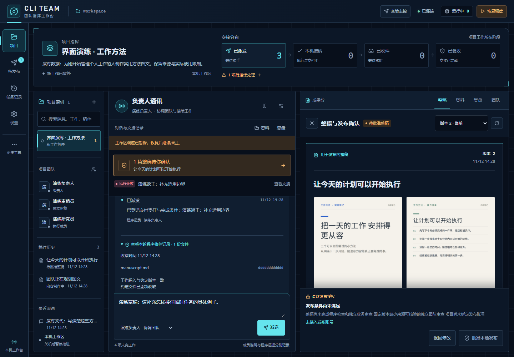
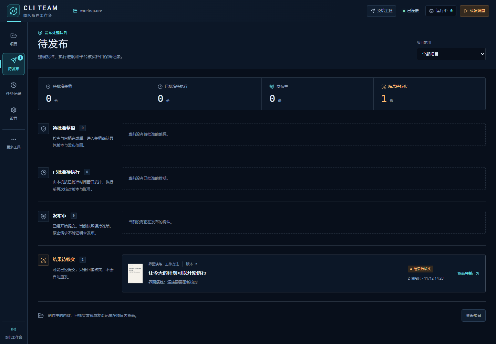
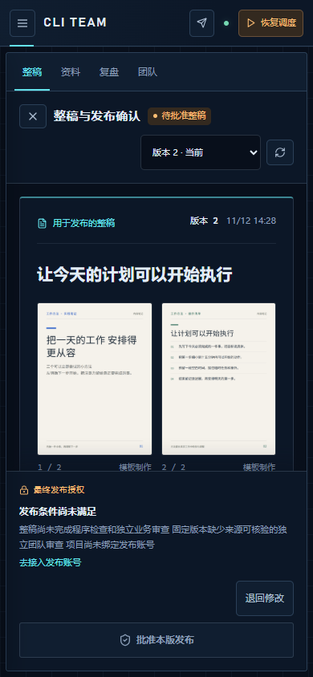

# 2026-11-12 科幻工作台改版验证

CLI Team 已改为深蓝与冰青色的中文指挥工作台。顶部展示项目目标和可定位的真实交接阶段，左侧保留项目索引，中间是负责人通讯，右侧是固定整稿审阅。待发布页改为处理队列，旧任务、团队讨论、成员和设置页面沿用相同主题。

这次界面改版连同[业务协作升级](2026-11-12-team-upgrade.md)一起交付。协作流程参考 [solo-to-team-skills](https://github.com/dabingfy-dot/solo-to-team-skills)，项目会话与成果布局参考 [LibreChat](https://github.com/LibreChat-AI/LibreChat)。界面没有增加模拟运行指标，也没有改变独立验收或最终发布条件。



## 布局与操作

- 交接栏按项目工作当前所处状态分别计数；失败和状态不明单独显示，点击定位具体交接。
- 负责人会话、材料和历史稿件保持挂载与草稿保存；切换成果时保留上下文。
- 整稿按版本、原始配图、正文、程序检查、成员审稿和最终发布授权组织。原始图片不施加主题滤镜。
- 待发布队列分别显示待批准、已批准待执行、发布中和结果待核实。未知提交继续冻结再次发布。
- 图片预览挂到顶层，覆盖主导航；预览期间主界面不可交互，关闭后焦点回到缩略图。
- 窄屏成果面板覆盖会话时，使用 `inert` 排除底层交互和键盘焦点；关闭后恢复操作，草稿保留。空成果面板不会禁用会话。



## 实际验证

环境：Windows x64、Node.js 24.12.0、Electron 44.7.0；浏览器为本机 Chrome，沙箱启用。

| 检查 | 结果 |
| --- | --- |
| `npm test` | **422 通过，0 失败、0 跳过、0 取消** |
| `npm run check` | TypeScript 检查通过 |
| `npm run build` | 构建通过，JS `index-BMVTAHO8.js`，CSS `index-DrGpVS2n.css` |
| `npm run smoke:business-ui` | **10/10 真实浏览器操作场景通过** |
| 页面与尺寸 | 14 组实际检查无横向溢出；项目覆盖 1440、1024、768、390px |
| 主按钮文字对比度 | 实际采样最低 **11.94:1**；范围是当时可见且启用的主按钮 |
| 减少动态效果 | 实际采样 671 个元素，0 违规 |
| 图片预览 | 覆盖功能导航；Tab / Shift+Tab 保持在预览内；关闭后恢复焦点和主界面交互 |
| 390px 成果覆盖 | 连续 20 次 Tab 未进入底层会话、项目索引或指挥条；关闭后可继续输入，草稿保留 |
| 本地图片 | 本轮 Electron 实际生成两张 1080×1440 PNG，中文字体与无溢出检查通过 |
| 桌面成品 | 生成新包；真实启动、界面加载、预加载、退出前草稿保存通过；普通浏览器访问返回 401；退出后后端停止、锁释放 |
| 成品独立核对 | 94 个运行文件与已测源码/构建逐字节一致；110 个生产依赖匹配源锁文件；真实快捷方式目标、参数与备份核对通过 |

浏览器操作覆盖新建项目、向负责人发消息、草稿与上下文切换、固定版本与图片、搜索定位、失败折叠、窄屏、退回修改、发布未知冻结以及旧任务深链接，并检查成员和设置页面。后两类导航没有写入配置。

浏览器验收使用真实 loopback 服务、实际 HTTP 请求和本轮新渲染 PNG，审稿与交接状态使用明确标注的演练数据。未运行官方 CLI，未进行真实账号登录或发文；验证中没有外站请求。构建文件在验收过程中保持不变。

成品独立核对的 12 项门禁全部通过，8172 个包内文件路径扫描没有发现指定工作目录或识别出的凭据路径。报告如实保留 `byteEqual: false`：`package.json` 经打包器默认规则移除开发字段，顶层 `package-lock.json` 被默认过滤。两项转换按本机打包器实际模块复现核对，安装依赖的名称、版本、来源与完整性元数据另与源锁文件比对；没有将整包宣称为源码的逐字节副本。

Vite 仍提示单入口超过 500 kB（本轮约 634 kB，gzip 约 188 kB）。构建通过，尚未做入口拆包或性能基准；Node SQLite 的实验性提示不影响本轮测试结果。

## 复跑

源码检出后在 Windows Node.js 24+ 环境执行：

```powershell
npm ci
npm test
npm run check
npm run build
npm run smoke:business-ui
npm run package:desktop
npm run smoke:desktop -- --packaged
```

[浏览器验收脚本](../../tools/smoke-business-ui.mjs)会新建隔离目录、调用本项目 Electron 渲染真实图片，然后启动本机 Chrome/Edge。可用 `CLI_TEAM_UI_BROWSER` 指定浏览器可执行文件的绝对路径。脚本不依赖既有演练产物；安装运行所需的浏览器失败时会明确停止，不关闭沙箱。

原始日志、机器收据和安装包仅保存在本机，不上传工作目录。以下是本次留档位置：

- 全库与构建：`work/scifi-upgrade-20261112/tests.log`、`check.log`、`build.log`。
- 浏览器：`work/scifi-ui-proof/run-St4oiT/ui-proof.json`，包含布局、实际对比度、键盘采样与构建摘要。
- 桌面成品：`release/2026-11-12T06-32-27-506Z/CLI Team-win32-x64/CLI Team.exe`，构建时间为 2026-11-12 14:32（Asia/Shanghai）。项目根目录 `CLI Team 桌面端.lnk` 已指向新包。
- 成品启动：`work/desktop-smoke/run-GBiX8k/desktop-smoke.json`。旧构建和快捷方式备份保留。
- 成品核对：`work/scifi-upgrade-20261112/package-verification.json`；快捷方式收据为 `work/desktop-shortcuts/update-sdDVtx/receipt.json`。

本次更新源码与本地桌面包，应用版本仍为 `0.1.0`。GitHub 既有 Releases 下载未替换；从源码构建可得到这次界面。真实模型内容生产、小红书登录与发布、AI 生图仍保留在[业务验证边界](2026-11-12-team-upgrade.md#未验证或尚未配置)中。

移动端整稿截图：


