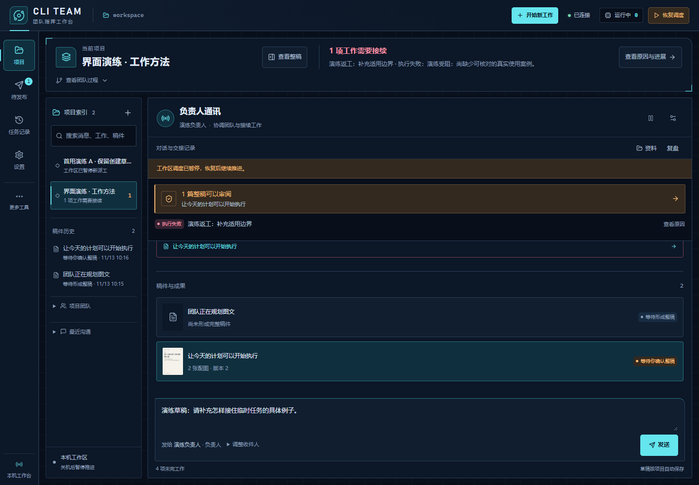
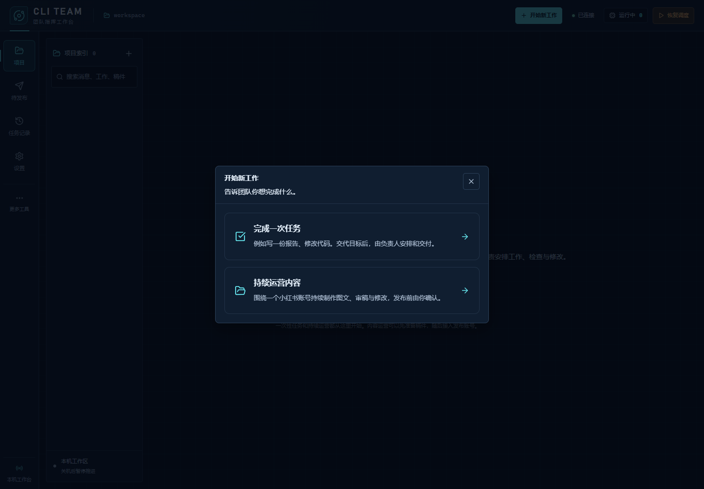
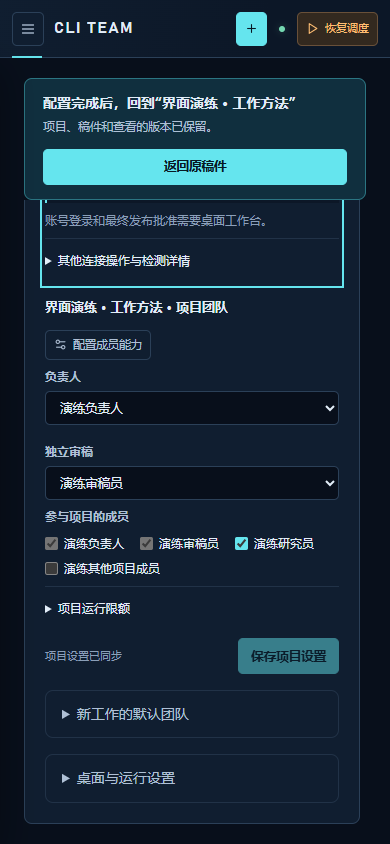
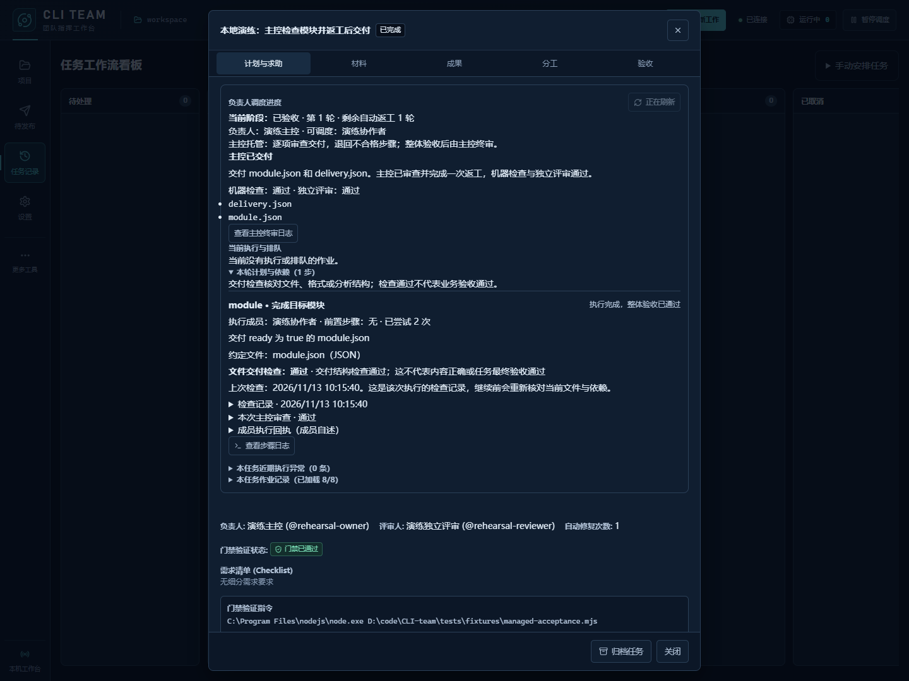

# 使用流程简化 · 2026-11-13 验证

本轮于 2026-11-12 开始，11-13 接续完成。日常操作收敛为“交代目标 → 团队推进 → 看成果、提修改”。继续采用深蓝冰青工作台、原有项目与任务服务，以及固定版本的机器检查、独立审稿和桌面发布确认。

## 日常路径

1. 点击“开始新工作”，按目标选择“完成一次任务”或“持续运营内容”。手动选择协作模式放在任务记录的“手动安排任务”中。
2. 缺少成员时先填写目标，再进入配置；保存后返回原创建草稿。新项目沿用默认团队的明确名单，默认团队缺审稿时只在其已授权成员内推荐。停用或缺失成员保留显示，由用户重新启用、换人或明确移除。
3. 项目默认显示会话和一句真实进展。团队交接、完整成果、成员列表与检查详情按需展开；失败、暂停、等待与结果未知仍有明确提示。消息默认发给负责人，指定其他成员的草稿仍保留。
4. 从稿件进入账号、团队或运行设置时，带上项目、稿件、版本和原位置，配置后直接返回。指定项目不存在或已归档时显示原因，不自动切到其他项目。
5. 整稿底部说明下一步，只有当前版本的机器检查、独立审稿和后端发布条件全部满足时才显示批准按钮。调整排期后直接打开返回的新版本；旧批准失效、结果未知与冻结提交仍明确显示。





## 配置与输入保护

- 未保存的项目设置会锁住项目切换与成员配置入口，可保存或明确撤销。项目被外部归档或移除时，当前编辑仍保留，提交停用。
- 配置返回入口固定在顶部，内容单独滚动。成员、账号和运行设置自动定位或滚动到底后，仍能返回原工作；390 像素窄屏也经过实际点击验证。
- “返回原工作”会等待草稿保存；保存失败、仍有未保存设置或用户已切换页面时，不跳走。保存期间打开新的成员编辑窗，也会取消返回，保留输入。
- 工作区暂停的下一步直接定位到“工作区调度”。恢复按钮说明影响本工作区全部有效项目和排队任务，进入设置不会自动恢复。
- 创建窗与成果面板关闭后恢复可用焦点；其他页面或对话框接管焦点时，不强行移回旧按钮。窄屏继续使用 `inert` 排除被覆盖的内容。
- 发布结果待核实时，操作定位到待核实提交的冻结版本；较新的失败请求不会覆盖定位。浏览器切换账号后，整稿会直接提示核对项目账号；账号就绪不代替后端批准条件。

<p align="center">
  
</p>

## 工程验证

环境为 Windows x64、Node.js 24.12.0、Electron 44.7.0；浏览器演练使用本机 Chrome、启用浏览器沙箱、真实回环服务和独立 SQLite 工作区。

| 检查 | 结果 |
| --- | --- |
| `npm test` | 445/445 通过，0 失败、0 取消、0 跳过；耗时约 637 秒 |
| `npm run check` | 最终产品源码检查通过 |
| `npm run build` | 通过；JS `index-BCPZTXYL.js`，CSS `index-DHqkND1M.css` |
| 真实浏览器流程 | 16/16 场景通过；17 组视觉检查、3 组响应布局通过 |
| 顶部返回入口 | 10 组几何与遮挡检查通过；桌面与窄屏滚动到底后，按实际坐标点击返回 |
| 保存期间的新编辑 | 延迟草稿保存 208 ms；返回等待期间输入成员编辑，保存完成后弹窗和内容保留，未提交成员 |
| 桌面成品启动 | 已打包成品通过启动、预加载、草稿保存、退出及本地服务关闭检查 |
| 桌面包独立核对 | 10/10 门禁通过；94 个运行文件、4 个构建文件及 110 个生产依赖核对一致，快捷方式指向本轮成品 |

浏览器回归没有页面错误、控制台错误或对外请求；沙箱保持启用，服务退出后释放工作目录锁。包核对独立复现 Electron Packager 对 `package.json` 的默认转换；不把转换后的清单误称为逐字节相同。依赖名称、版本及锁定信息全部一致，不声称重新核验每个依赖包的完整归档字节。项目快捷方式的原参数和工作目录保留，并有本次更新前的备份。

全量测试包含本轮默认团队、稿件冻结版本和账号切换回归；未把此前定向运行重复计入总数。Vite 保留入口超过 500 kB 的体积提示，本轮未进行拆包或性能基准。

交付演练使用固定 Node 协议客户端，实际完成 8 次进程运行、一次返工与机器验收。验收测试 1 项通过、0 跳过，独立评审与主控终审通过，最终交付绑定同一产物版本。截图没有修改页面内容或样式。



浏览器业务场景中的审稿与交接状态使用明确标注的演练记录，不能代表真实模型的内容质量。交付演练和 UI 检查均没有调用真实模型或进行真实平台登录、发文，业务发布边界继续见[业务升级记录](2026-11-12-team-upgrade.md)。

## 本地证据与复跑

原始机器收据、日志、工作区和安装包只保存在本机，截图与可复跑工具随源码提交：

- 测试、构建、UI 与成品记录：`work/workflow-simplification-20261112/`，继续使用本轮最初的证据目录。
- 最终全量测试：`npm-test-final-20261113.log` 和对应 JSON；类型检查与构建分别为 `npm-check-final-20261113.*`、`npm-build-final-20261113.*`。
- 最终构建清单：`build-assets-final-20261113.json`，包含完整 `dist` 四个文件的 SHA-256。
- 浏览器流程：`ui-proof/run-PhqMzd/ui-proof.json`；交付演练：`managed-run-f0Wvi0/managed-delivery-receipt.json`。
- 桌面包核对：`package-verification-final-20261113.json`；成品启动：`work/desktop-smoke/run-aGs0nJ/desktop-smoke.json`。
- 截图来源及哈希：`screenshots-final-20261113.json`，均为本轮构建的实际画面，未编辑截图内容。

```powershell
npm ci
npm test
npm run check
npm run build
npm run smoke:business-ui
npm run package:desktop
npm run smoke:desktop -- --packaged
```

本轮更新源码与本地桌面包，应用版本仍为 `0.1.0`；GitHub 既有 Releases 下载未替换。历史截图与验证记录保留各自的实际构建，README 展示本轮操作路径。
