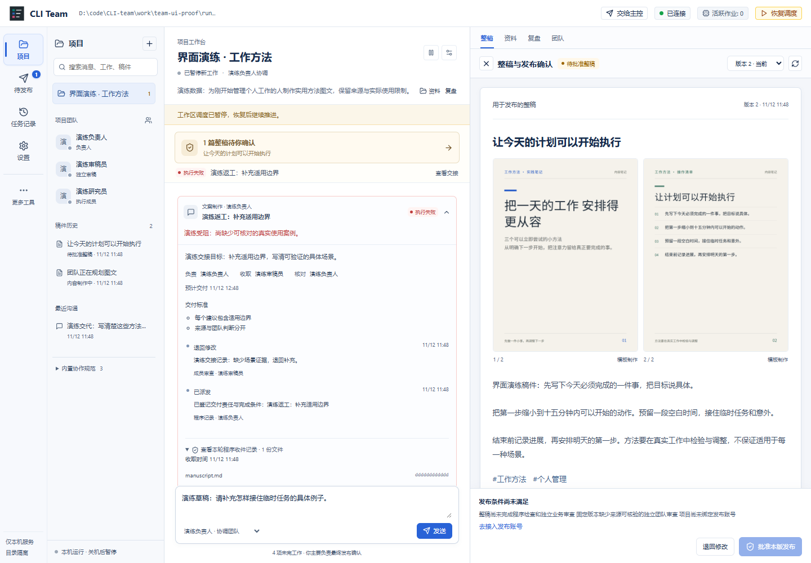

# 2026-11-12 项目工作台升级验证

原始日志、桌面包和机器收据仅在本地留档，不随源码上传。下文标注“本地”的路径供验收机器查阅；仓库保留验证结论、截图和可复跑的源码。

本次在现有 CLI Team 中实现项目、负责人会话和固定整稿并排的工作台，以及实际收件后独立核验的团队流程。保留原有任务、讨论和官方 CLI 接入；没有启动生产工作区、迁移实际业务数据或进行真实发文。

本文记录 12:06 的业务升级基线；同日后续的科幻界面、更新后的桌面包和验收见[科幻工作台改版记录](2026-11-12-scifi-workbench.md)。

## 本地桌面入口

已生成 2026-11-12 12:06（Asia/Shanghai）的 Windows x64 桌面包，应用版本仍为 `0.1.0`，以构建目录区分本次升级。项目根目录的 CLI Team 桌面端.lnk（本地：`CLI Team 桌面端.lnk`） 已指向新包；旧包和原快捷方式均保留。

- 直接打开新版 CLI Team.exe（本地：`release/2026-11-12T04-06-27-723Z/CLI Team-win32-x64/CLI Team.exe`）。移动时保留整个程序目录，内置 Node.js 24.12.0 和 Electron 44.7.0。
- 构建日志（本地：`work/team-upgrade-release-20261112/package.log`）、快捷方式核对与备份（本地：`work/desktop-shortcuts/update-vARQfN/receipt.json`）。仅更新项目中的既有入口及描述，保留启动参数和工作目录。
- 成品启动收据（本地：`work/desktop-smoke/run-aLSLQz/desktop-smoke.json`）：真实执行新包，界面与预加载通过，普通浏览器访问返回 401，退出前草稿保存通过，后端停止且工作目录锁已释放。
- 成品文件与依赖核对（本地：`work/team-upgrade-release-20261112/package-verification.json`）：93 个运行文件的 SHA256 与源码及已测构建一致，包括 Windows 进程监督器与整稿界面；实际安装的 110 个生产依赖全部对应源锁文件，名称、版本及安装锁元数据一致。扫描 8171 个成品文件，未发现指定工作目录或识别出的凭据路径。

成品核对明确记录 `byteEqual: false`：打包器默认从 `package.json` 移除 `private`、`scripts`、`devDependencies` 等开发字段，并默认过滤源 `package-lock.json`。实际成品清单与本机打包器默认转换结果完全一致；这两项已解释的转换与运行文件的逐字节一致性分别核验，未将整包宣称为源码的逐字节副本。

本轮没有向 GitHub 发布新版本，既有 Releases 下载不包含这次本地构建。旧工作区的首次升级仍受下文的数据保护条件约束。

## 两个参考项目如何进入实现

| 参考 | 实际改动 | 代码 |
| --- | --- | --- |
| [solo-to-team-skills，固定提交 bc9c194](https://github.com/dabingfy-dot/solo-to-team-skills/tree/bc9c19458e9d4afe42e506fc65673a68c26c6a56) | 明确执行、收件、跟进责任和验收条件；保留原承诺；追加派工、收件、核验、退回、受阻及改期记录；失败保持未完，负责人必须作出具体处理。 | `server/business-handoffs.mjs`、`business-skills.mjs`、`business-work.mjs` |
| [LibreChat，固定提交 e6567c7](https://github.com/LibreChat-AI/LibreChat/tree/e6567c7a681ce67869dce31486a21d3a25d6931b) | 项目会话、可折叠成员活动、成果侧栏；搜索定位具体消息、交接和版本；持久作业、去重、租约与保守恢复。 | `ui/projects/`、`ui/content/`、`server/business-store.mjs`、`business-scheduler.mjs` |

上述规则和交互在 CLI Team 中重新实现，未复制上游运行代码。solo-to-team-skills 提供技能和案例，本身不负责启动成员；LibreChat 的数据库和 Agents 运行体系没有整体迁入。本地 SQLite 继续是业务状态的唯一来源。内置三项协作规范有版本与摘要，随本次固定输入交给成员；技能文字不能授予新的权限。

## 已完成的使用流程

- 左侧项目、团队和历史；中间负责人会话及阶段交接；右侧整稿、资料、团队和复盘。切换成果与上下文保留会话和草稿。
- 项目内搜索定位原消息、工作交接和固定稿件版本；窄屏搜索自动显示命中的会话。1440、1024、768、390 像素宽度均无横向溢出。
- 成员调用成功先收取声明文件或完整章节，保存机器收件，再由独立成员验收。普通下游工作只在上游 `verified` 后执行。
- 原生稿件版本不可变，旧稿可看。退回生成新代工作和新稿件，迟到的收件、审稿或协调意见不能推进当前版本。只改排期时，在图文、来源和依赖一致的条件下保存审稿复用出处，发布批准仍撤销。
- 失败、工具受阻、逾期和返工进入负责人处理。重排同一责任工作保留已用尝试次数和原交期；旧分工明确结束，咨询重试后恢复当前问题的答复交接。
- MCP／CLI 新增业务项目创建、交代、资料、素材、状态、固定整稿预览和退回。写请求持久去重；主控提交保留来源，不冒充用户材料或已采纳事实。项目技能已补业务操作说明并通过结构校验。

界面截图使用明显标注的演练数据：

## 测试结果

环境：Windows x64、Node.js 24.12.0、Electron 44.7.0。

| 检查 | 实际结果 | 证据 |
| --- | --- | --- |
| `npm test` | **422 通过，0 失败、0 跳过、0 取消** | 最终完整日志（本地：`work/team-upgrade-tests-20261112-final.log`） |
| `npm run check` | TypeScript 检查通过 | 日志（本地：`work/team-upgrade-check-20261112.log`） |
| `npm run build` | 构建通过，生成 `index-hzeaiws_.js` 和 `index-C_40nuGz.css` | 日志（本地：`work/team-upgrade-build-20261112.log`） |
| 浏览器实际操作 | 10/10 通过；真实 loopback 服务、实际 HTTP 写入和 PNG，演练审稿状态；无控制台错误，Chrome sandbox 开启 | 机器记录（本地：`work/team-ui-proof/run-aZaWme/ui-proof.json`）、可重跑脚本（本地：`work/team-ui-browser-proof.mjs`） |
| 真实本地执行旅程 | 10 个 Node 进程完成规划、并行制作、独立接收、第一稿退回和第二稿通过；两稿摘要不同；0 发布批准、0 发布尝试 | [运行测试](../../tests/business-runtime.test.mjs)及完整日志 |
| 真实 Windows 进程树 | 父进程退出而孙进程仍运行时继续占用；Job Object 先绑定再运行，全部退出才写凭据；新宿主可读取凭据恢复 attempt；无凭据保持隔离 | [进程测试](../../tests/process-supervision.test.mjs)、[恢复测试](../../tests/business-recovery.test.mjs) |
| Electron 图文排版 | 封面和清单各生成 1080×1440 PNG；中文字体加载、实际尺寸与溢出检查通过，超量文字被明确拒绝 | 机器记录（本地：`work/team-upgrade-render-1794454781897/render-smoke.json`）、清单成品（本地：`work/team-upgrade-render-1794454781897/list.png`） |
| 开发版桌面启动 | 预加载、界面加载、退出前草稿保存通过；普通浏览器访问返回 401；退出后后端停止并释放锁 | 机器记录（本地：`work/desktop-smoke/run-Hf8rZL/desktop-smoke.json`） |
| `npm run package:desktop`、成品启动 | Windows 包生成且项目快捷方式更新；成品界面、预加载、访问边界、退出保存和服务停止通过 | 构建日志（本地：`work/team-upgrade-release-20261112/package.log`）、成品烟测（本地：`work/team-upgrade-release-20261112/packaged-smoke.log`） |
| 成品独立核对 | 93 个运行文件 SHA256 一致；110 个生产依赖全部匹配；默认清单转换与锁文件过滤已核实，扫描前后输入稳定 | 机器记录（本地：`work/team-upgrade-release-20261112/package-verification.json`）、核对脚本（本地：`work/team-upgrade-release-20261112/verify-package.mjs`） |
| 主控技能结构 | `quick_validate.py` 通过 | [技能入口](../../skills/cli-team-controller/SKILL.md)、[项目操作说明](../../skills/cli-team-controller/references/projects.md) |

首轮全库检查发现两组旧客户端迁移测试注入的残缺队列记录触发异步 SQLite 参数错误。调度器已在读取关联数据前检查运行身份，保留成员预留并记录一次明确阻碍，有效后续任务可继续。修复保留原测试断言，最终重新执行全库并全部通过。[新增兼容回归](../../tests/execution-scheduler.test.mjs)。

Vite 有单个入口压缩后超过 500 kB 的提示（约 620 kB，gzip 约 184 kB），不影响本次构建；尚未做入口拆包或启动性能基准。Node 内置 SQLite 输出实验性 API 提示，测试执行正常。

## 恢复和兼容边界

租约到期、根 PID 消失或旧版 `processExitConfirmed: true` 均不能证明整个进程树已经退出。本轮保存带版本的退出证据；未决树占用成员及全局并发槽，避免重启后重复调用。Windows 首次使用监督器依赖系统 .NET Framework 编译器，缺失时在启动 CLI 前明确失败。

旧工作区升级要求原服务和排队任务已停止，迁移前保存一致数据库和工作文件快照；新写入器保护拒绝旧版写同一数据库。恢复旧版使用独立目录。本轮在隔离测试目录验证迁移、回退与 writer 保护，没有迁移实际用户工作区。

## 未验证或尚未配置

| 门禁 | 当前范围 |
| --- | --- |
| 真实官方模型完成内容生产 | 未执行。本轮进程旅程使用实际 Node 子进程和确定性报告，DSH 协议回归使用替身；不证明模型质量或官方账号额度可用。 |
| 真实账号登录与发布页能力 | 未执行。连接器保留受控检测，缺少上传映射、创建身份或整稿回读能力时不能批准。 |
| 原生最终发布确认 | 权限、版本绑定、取消和导航失效已有测试；本轮未让用户对真实稿件点击最终发布。 |
| 真实平台发文、回读及指标 | 未执行。返回成功或候选笔记不算发布证据；结果不确定必须先核实，缺失指标显示未知。 |
| AI 生图 | 尚未配置；当前提供本地模板 PNG 与用户导入素材，需要真实照片时不能用模板冒充。 |
| 持续在线服务 | 应用运行期间调度有效项目；没有新增开机自启、云端托管或关机期间执行。 |

所有验证均使用隔离工作区。界面演练、程序收件和真实平台证据分别记录，不互相替代。
