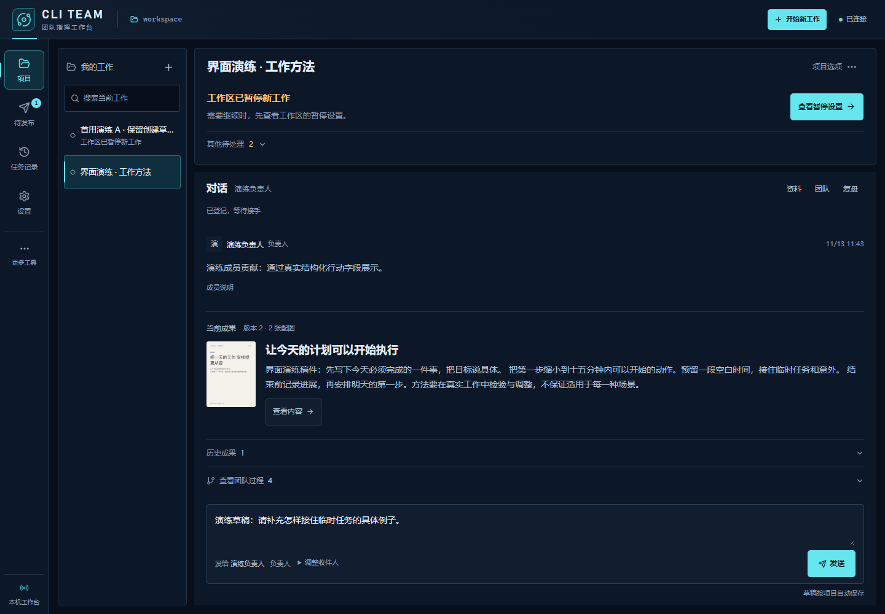
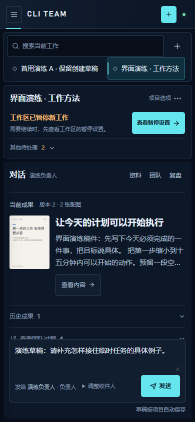
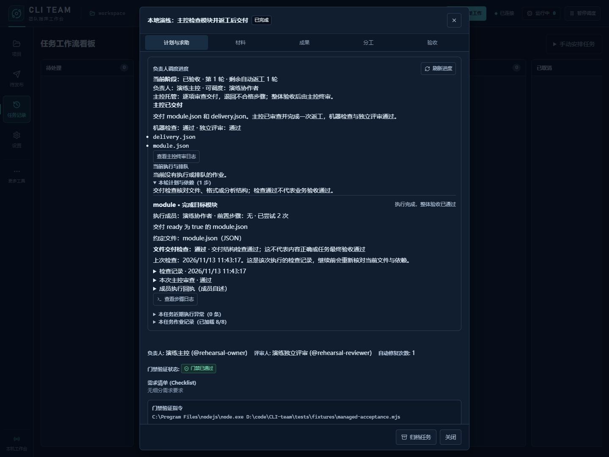

# 日常工作台优化 · 2026-11-13

上一轮打通了创建、配置返回和整稿审阅，但项目默认页仍有重复的暂停、工作失败和待审提示，同一稿件也出现在多个位置。本轮将默认页收敛为工作列表、一个下一步、对话和一份当前成果。

## 实际变化

- 左侧只用于选择工作和搜索当前项目。项目标题、团队设置、发布账号、运行设置及项目暂停集中在当前项目顶部。
- 当前状态由同一套规则决定优先顺序。发布结果待核实、正在提交、暂停、团队配置、失败和待审各自保留明确含义；其余需处理类别放入“其他待处理”，数量直接可见。展开后可进入对应工作或固定版本稿件。
- 默认只显示一份当前成果，包括标题、首图和正文摘要。打开整稿面板后收起重复预览，历史成果排除当前稿件并默认折叠。团队过程独立展开，搜索命中后自动展开、定位。
- 去掉会话内的重复提示条，以及项目页顶部常驻的全局运行数量与暂停按钮。运行设置仍提供工作区控制，项目菜单提供单个项目暂停和继续。
- 待核实或提交中的成果始终绑定原提交版本；冻结稿件未读到时显示缺失原因，不拿新稿代替。机器收件、成员说明、独立审稿和发布条件继续分别表达。



<p align="center">
  
</p>

## 交互与回归

真实浏览器检查覆盖暂停、失败和待审同时存在的状态。默认推荐区、当前成果和当前稿件标题各一处，团队工作记录默认折叠。失败详情、历史稿件、项目搜索及原配置返回路径均保留。

实现过程发现并修复了项目切换时兄弟组件使用重复 React key 的问题，新增 DOM 数量检查防止旧项目状态栏残留。次级状态条目使用稳定分类键，避免无关状态更新重建按钮并丢失焦点。保存过程中进入成员或账号设置的入口也遵守工作区忙碌状态。

首次进入和稿件版本变化时定位当前成果，同一稿件收到新回复时定位最新消息。主动阅读历史或团队过程后停止自动跟随，只显示新进展入口；点击后回到相应消息或成果。摘要只压缩预览中的空白，完整正文不变。成果面板覆盖工作台时，背后内容保持不可聚焦，项目菜单随覆盖状态收起。

## 本轮验证

环境为 Windows x64、Node.js 24.12.0、Electron 44.7.0。浏览器演练使用本机 Chrome、真实回环服务和独立 SQLite 工作区，浏览器沙箱保持启用。

| 检查 | 结果 |
| --- | --- |
| `npm test` | 458/458 通过，0 失败、0 取消、0 跳过；耗时约 503 秒 |
| `npm run check` | 最终源码类型检查通过 |
| `npm run build` | 最终构建通过；JS `index-BKVYrZxY.js`、CSS `index-Ch_S5HEn.css` |
| 浏览器流程 | 最终 17/17 场景通过，19 组视觉检查、3 组响应布局通过 |
| 默认信息量 | 三组页面均为 1 个推荐区、1 份当前成果、1 处当前稿件标题、0 个展开工作阶段 |
| 新回复与阅读位置 | 390 宽度下自动跟随、关闭稿件返回回复、历史阅读保护、点击回到最新四段验证通过；历史行位置仅变化 0.1875 px |
| 成品启动 | 最新桌面包成功加载页面与预加载脚本，保存草稿，拒绝未经桌面认证的浏览器请求，退出后本地服务关闭 |
| 桌面包独立核对 | 10/10 门禁通过；94 个运行文件、4 个构建文件与 110 个生产依赖核对通过，实际快捷方式与本次备份核对一致 |
| 确定性交付演练 | 9/9 检查通过；8 次实际协议进程、1 次返工、1 项机器验收且 0 跳过，独立评审与主控终审通过 |

全量测试新增组合状态和冻结稿件回归，定向检查不重复计入总数。最后的会话滚动调整由最终构建上的浏览器回归验证。浏览器运行期间构建哈希未变，页面错误、控制台错误和外部页面请求均为 0；工作区锁已释放。Vite 仍提示入口超过 500 kB，本轮没有进行拆包或性能基准。

包核对独立重现了 Electron Packager 对 `package.json` 的转换，不将转换后的清单称为逐字节相同。生产依赖名称、版本和锁定信息全部一致；核对范围不包含每个依赖归档的完整字节。实际项目快捷方式指向 `release/2026-11-13T03-44-31-514Z/CLI Team-win32-x64/CLI Team.exe`，原参数和工作目录保留，本次备份与打包前基线一致。



## 证据与复跑

本轮原始日志、收据、独立 SQLite 工作区和安装包保存在本机的 `work/workbench-focus-20261113/` 与 `release/` 中。README 和本页截图来自本轮实际构建；上一轮截图与验证记录保持原样，可用作视觉参考。

- 全量测试：`test.log` 与 `test.json`；最终类型检查和构建：`check.*`、`build.*`，完整构建哈希为 `build-assets.json`。
- 最终浏览器证据：`ui-proof/run-bpeqlN/ui-proof.json`，包括默认信息量、几何、消息与历史滚动记录。
- 最终交付演练：`managed-run-uManvF/managed-delivery-receipt.json`。演练成果绑定实际验收的产物版本。
- 最新桌面包日志：`package-desktop.*`；成品启动日志：`smoke-desktop.*`，底层收据为 `work/desktop-smoke/run-OZhUq2/desktop-smoke.json`。
- 桌面包核对：`package-verification.json`，打包前基线为 `package-baseline-final.json`，真实快捷方式更新收据为 `work/desktop-shortcuts/update-iKT9jy/receipt.json`。
- 截图来源与哈希：`screenshots.json`，文档图片与实际截图逐字节相同，未修改页面或图片内容。

早期未完整通过的浏览器演练保留独立记录，最终结果只统计 `run-bpeqlN`。其中修复了真实的重复组件键问题；其他脚本修正包括等待定位生效、复用已创建的历史稿以遵守待处理名额，以及将作者断言限定到对应正文行。

```powershell
npm test
npm run check
npm run build
npm run smoke:business-ui
npm run package:desktop
npm run smoke:desktop -- --packaged
```

浏览器演练使用明确标注的业务记录，交付演练使用确定性的 Node 协议客户端。两者均不调用真实模型，也不代表真实账号登录或平台发文验证。应用版本仍为 `0.1.0`，本轮更新源码与本地桌面包，GitHub 现有 Release 下载未替换。
